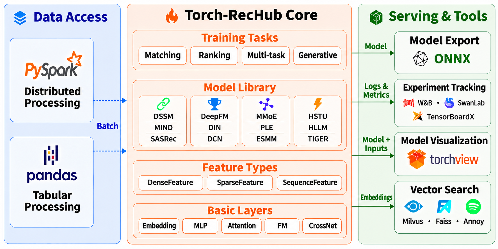

<div align="center">


**Study 30+ PyTorch recommender models alongside their papers, from two-tower retrieval to generative recommendation, and train them on your own data.**

[](https://pypi.org/project/torch-rechub/)
[](docs/en/guide/install.md)
[](LICENSE)

English | [简体中文](README_zh.md)

</div>

**[Documentation](https://datawhalechina.github.io/torch-rechub/)**

## Use cases

* **Teaching and self-study** — Step through Jupyter examples and read the PyTorch code to see how feature interactions and two-tower retrieval work.
* **Recommendation competitions** — Train a baseline and compare ranking AUC or retrieval Recall@K on the same data split.
* **Small recommendation teams** — Train ranking models across multiple GPUs on one machine. Export supported models to ONNX for your inference service, which handles replicas and routes requests.

## ✨ Features

* **Features and training** — Combine sparse, dense, and sequence features. User histories and candidate items can share an embedding table. Each task has a trainer for training and evaluation.
* **Hardware support** — Train on NVIDIA GPUs (CUDA), AMD GPUs (ROCm), Huawei Ascend NPUs (CANN), or CPUs.
* **Retrieval and export** — Generate user and item embeddings separately with a two-tower model, then search for nearest neighbors with Annoy, Faiss, or Milvus. Supported models can also be exported to ONNX.
* **Experiment tools** — Inspect model graphs in Jupyter with torchview and track training loss and evaluation metrics with W&B, SwanLab, or TensorBoardX.

## 🔧 Installation

### Requirements

* Python 3.10 or later
* PyTorch 2.6 or later in the 2.x series

For CPU training, follow the steps below. For GPU or NPU training, install the PyTorch build for your device first. [Device installation examples](docs/en/guide/install.md#install-pytorch-for-your-device)

### Installation steps

**Install the stable release in your own project**

```bash
python -m pip install torch-rechub
```

**Install from source to run the repository examples**

```bash
# Install uv if needed
python -m pip install uv

git clone https://github.com/datawhalechina/torch-rechub.git
cd torch-rechub
uv sync
```

`uv sync` creates the project's `.venv` and installs its dependencies. Use `uv run` to run examples in that environment.

### Optional dependencies

Install an extra with `uv sync --extra <name>` or `python -m pip install "torch-rechub[<name>]"`. The installation guide lists the extras and their system requirements. [Optional features](docs/en/guide/install.md#optional-features)

## 🚀 Quick start

After installing from source, start in the repository root and train DeepFM for one epoch on the bundled Criteo sample using the CPU.

```bash
cd examples/ranking
uv run python run_criteo.py --model_name deepfm --epoch 1 --batch_size 8 --device cpu
```

The script prints training loss, validation AUC, and test AUC, and saves the weights to `examples/ranking/model.pth`. The small sample lets you check the training workflow end to end.

## Benchmark · MovieLens-1M full-catalog retrieval

| Model | GAUC | Recall@5 / Hit@5 | Recall@10 / Hit@10 | NDCG@5 | NDCG@10 |
| --- | ---: | ---: | ---: | ---: | ---: |
| SINE | 0.837437 | 0.106623 | 0.168212 | 0.068642 | 0.088378 |
| STAMP | 0.839963 | 0.095199 | 0.149834 | 0.059889 | 0.077447 |
| GRU4Rec | 0.858918 | 0.090563 | 0.147351 | 0.056654 | 0.074937 |
| ComirecDR | 0.854196 | 0.082781 | 0.131126 | 0.052228 | 0.067701 |
| SASRec | 0.832628 | 0.080629 | 0.126159 | 0.051157 | 0.065777 |
| YoutubeDNN | 0.818883 | 0.058609 | 0.103477 | 0.035582 | 0.049994 |
| MIND | 0.827980 | 0.048510 | 0.084272 | 0.029637 | 0.041174 |
| DSSM | 0.805208 | 0.046854 | 0.083444 | 0.029233 | 0.040895 |
| ComirecSA | 0.834305 | 0.045861 | 0.081291 | 0.027935 | 0.039161 |
| NARM | 0.806611 | 0.039073 | 0.074503 | 0.023360 | 0.034827 |

[Full results and reproduction guide](docs/en/tools/benchmark.md)

## 💡 Model library

* **Retrieval** — DSSM, FaceBookDSSM, YouTubeDNN, YouTubeSBC, MIND, SINE, ComiRec (DR and SA), GRU4Rec, SASRec, NARM, and STAMP.
* **Ranking** — Wide & Deep, DeepFM, DCN, DCNv2, EDCN, AFM, AutoInt, FiBiNET, DeepFFM, FAT-DeepFFM, DIN, DIEN, and BST.
* **Multi-task learning** — SharedBottom, ESMM, MMoE, PLE, and AITM.
* **Sequential and generative recommendation** — HSTU, HLLM, TIGER, and RQ-VAE for building semantic IDs.

[Model guides and papers](docs/en/models/intro.md)

## Framework overview



<details>
<summary>Browse the repository layout</summary>

```
torch-rechub/             # Root directory
├── README.md             # Project documentation
├── pyproject.toml        # Project configuration and dependencies
├── torch_rechub/         # Core library
│   ├── basic/            # Basic components
│   │   ├── activation.py # Activation functions
│   │   ├── features.py   # Feature engineering
│   │   ├── layers.py     # Neural network layers
│   │   ├── loss_func.py  # Loss functions
│   │   └── metric.py     # Evaluation metrics
│   ├── models/           # Recommendation model implementations
│   │   ├── matching/     # Matching models (DSSM/MIND/GRU4Rec etc.)
│   │   ├── ranking/      # Ranking models (WideDeep/DeepFM/DIN etc.)
│   │   ├── multi_task/   # Multi-task models (MMoE, ESMM, etc.)
│   │   └── generative/   # Generative models (HSTU, HLLM, TIGER, etc.)
│   ├── trainers/         # Training frameworks
│   │   ├── ctr_trainer.py    # CTR prediction trainer
│   │   ├── match_trainer.py  # Matching model trainer
│   │   └── mtl_trainer.py    # Multi-task learning trainer
│   ├── serving/          # Vector indexing and search
│   └── utils/            # Utility functions
│       ├── data.py       # Data processing utilities
│       ├── match.py      # Matching utilities
│       ├── mtl.py        # Multi-task utilities
│       └── onnx_export.py # ONNX export utilities
├── examples/             # Example scripts
│   ├── matching/         # Matching task examples
│   ├── ranking/          # Ranking task examples
│   └── generative/       # Generative recommendation examples (HSTU, HLLM, etc.)
├── docs/                 # Documentation (VitePress, multi-language)
├── tutorials/            # Jupyter tutorials
├── tests/                # Unit tests
└── config/               # Configuration files
```

</details>

## 👨‍💻‍ Contributors

Thanks to all contributors!


[](https://github.com/datawhalechina/torch-rechub/graphs/contributors)

## 🤝 Contributing

We welcome contributions in all forms! Please refer to [CONTRIBUTING.md](CONTRIBUTING.md) for detailed contribution guidelines.

We also welcome bug reports and feature suggestions through [Issues](https://github.com/datawhalechina/torch-rechub/issues).

## 📜 License

This project is licensed under the [MIT License](LICENSE).

## 📚 Citation

If you use this framework in your research or work, please consider citing:

```bibtex
@misc{torch_rechub,
    title = {Torch-RecHub},
    author = {Datawhale},
    year = {2022},
    publisher = {GitHub},
    journal = {GitHub repository},
    howpublished = {\url{https://github.com/datawhalechina/torch-rechub}},
    note = {A PyTorch-based recommender system framework providing easy-to-use and extensible solutions}
}
```

## 📫 Contact

* **Project Lead:** [1985312383](https://github.com/1985312383)
* [**GitHub Discussions**](https://github.com/datawhalechina/torch-rechub/discussions)

## ⭐️ Star History

[](https://mv.datawhale.cc/repo-badge?repo=torch-rechub)
