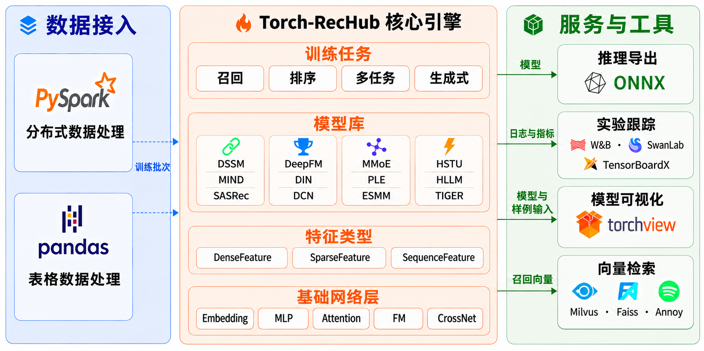

<div align="center">


**对照论文读懂推荐模型，再用自己的数据验证效果——从双塔召回到生成式推荐，这里有 30 多种可训练的 PyTorch 实现。**

[](https://pypi.org/project/torch-rechub/)
[](docs/zh/guide/install.md)
[](LICENSE)

[English](README.md) | 简体中文

</div>

**[在线文档](https://datawhalechina.github.io/torch-rechub/zh/)**

## 适用场景

* **教学与自学**　在 Jupyter 中逐步运行示例，对照 PyTorch 源码理解特征交叉和双塔召回。
* **推荐算法竞赛**　用现成模型建立基线，在固定的数据划分上比较排序 AUC 或召回率（Recall@K）。
* **中小团队的业务推荐**　可在单机多卡上训练排序模型。上线时可将适配模型导出为 ONNX，交给已有推理服务。多卡推理的实例管理和请求分发由服务端负责。

## ✨ 特性

* **特征与训练**　稀疏、连续和序列特征可以组合使用，用户历史和候选物品可以共享 embedding。各任务的 Trainer 负责训练与评估。
* **硬件支持**　可使用 NVIDIA GPU（CUDA）、AMD GPU（ROCm）、华为昇腾 NPU（CANN）或 CPU 训练模型。
* **检索与导出**　双塔模型可以分别输出用户和物品向量，接入 Annoy、Faiss 或 Milvus 做近邻检索。支持将适配的模型导出为 ONNX。
* **实验工具**　在 Jupyter 中用 torchview 查看模型结构，用 W&B、SwanLab 或 TensorBoardX 记录训练损失和评估指标。

## 🔧 安装

### 环境要求

* Python 3.10+
* PyTorch 2.6+（< 3.0）

CPU 环境可直接按下文安装。使用 GPU 或 NPU 时，先按[设备安装示例](docs/zh/guide/install.md#按设备安装-pytorch)准备对应的 PyTorch 环境。

### 安装步骤

**在自己的项目中安装稳定版**

```bash
python -m pip install torch-rechub
```

**从源码安装并运行仓库示例**

```bash
# 首先安装 uv（如果尚未安装）
python -m pip install uv

# 克隆并安装
git clone https://github.com/datawhalechina/torch-rechub.git
cd torch-rechub
uv sync
```

`uv sync` 会创建项目的 `.venv` 并安装依赖；后续通过 `uv run` 使用这个环境运行示例。

### 可选依赖

可通过 `uv sync --extra <name>` 或 `python -m pip install "torch-rechub[<name>]"` 安装可选功能。各依赖组的用途与系统依赖见[可选功能](docs/zh/guide/install.md#可选功能)。

## 🚀 快速开始

从源码安装后，在仓库根目录执行以下命令，用自带的 Criteo 样本在 CPU 上训练一轮 DeepFM。

```bash
cd examples/ranking
uv run python run_criteo.py --model_name deepfm --epoch 1 --batch_size 8 --device cpu
```

终端会输出训练损失、验证 AUC 和测试 AUC，模型权重保存在 `examples/ranking/model.pth`。这份小样本用于验证训练流程。

## Benchmark · MovieLens-1M 全库召回

| 模型 | GAUC | Recall@5 / Hit@5 | Recall@10 / Hit@10 | NDCG@5 | NDCG@10 |
| --- | ---: | ---: | ---: | ---: | ---: |
| SINE | 0.837437 | 0.106623 | 0.168212 | 0.068642 | 0.088378 |
| STAMP | 0.839963 | 0.095199 | 0.149834 | 0.059889 | 0.077447 |
| GRU4Rec | 0.858918 | 0.090563 | 0.147351 | 0.056654 | 0.074937 |
| ComirecDR | 0.854196 | 0.082781 | 0.131126 | 0.052228 | 0.067701 |
| SASRec | 0.832628 | 0.080629 | 0.126159 | 0.051157 | 0.065777 |
| YoutubeDNN | 0.818883 | 0.058609 | 0.103477 | 0.035582 | 0.049994 |
| MIND | 0.827980 | 0.048510 | 0.084272 | 0.029637 | 0.041174 |
| DSSM | 0.805208 | 0.046854 | 0.083444 | 0.029233 | 0.040895 |
| ComirecSA | 0.834305 | 0.045861 | 0.081291 | 0.027935 | 0.039161 |
| NARM | 0.806611 | 0.039073 | 0.074503 | 0.023360 | 0.034827 |

[完整结果与复现方法](docs/zh/tools/benchmark.md)

## 💡 已实现的模型

* **召回**　DSSM、FaceBookDSSM、YouTubeDNN、YouTubeSBC、MIND、SINE、ComiRec（DR / SA）、GRU4Rec、SASRec、NARM、STAMP。
* **排序**　Wide & Deep、DeepFM、DCN、DCNv2、EDCN、AFM、AutoInt、FiBiNET、DeepFFM、FAT-DeepFFM、DIN、DIEN、BST。
* **多任务学习**　SharedBottom、ESMM、MMoE、PLE、AITM。
* **序列与生成式推荐**　HSTU、HLLM、TIGER，以及用于构建语义 ID 的 RQ-VAE。

[模型文档与论文](docs/zh/models/intro.md)

## 框架总览



<details>
<summary>查看代码目录</summary>

```
torch-rechub/             # 根目录
├── README.md             # 项目文档
├── pyproject.toml        # 项目配置和依赖
├── torch_rechub/         # 核心代码库
│   ├── basic/            # 基础组件
│   │   ├── activation.py # 激活函数
│   │   ├── features.py   # 特征工程
│   │   ├── layers.py     # 神经网络层
│   │   ├── loss_func.py  # 损失函数
│   │   └── metric.py     # 评估指标
│   ├── models/           # 推荐模型实现
│   │   ├── matching/     # 召回模型（DSSM/MIND/GRU4Rec等）
│   │   ├── ranking/      # 排序模型（WideDeep/DeepFM/DIN等）
│   │   ├── multi_task/   # 多任务模型（MMoE/ESMM等）
│   │   └── generative/   # 生成式模型（HSTU/HLLM/TIGER等）
│   ├── trainers/         # 训练框架
│   │   ├── ctr_trainer.py    # CTR预测训练器
│   │   ├── match_trainer.py  # 召回模型训练器
│   │   └── mtl_trainer.py    # 多任务学习训练器
│   ├── serving/          # 向量索引与检索接口
│   └── utils/            # 工具函数
│       ├── data.py       # 数据处理工具
│       ├── match.py      # 召回工具
│       ├── mtl.py        # 多任务工具
│       └── onnx_export.py # ONNX 导出工具
├── examples/             # 示例脚本
│   ├── matching/         # 召回任务示例
│   ├── ranking/          # 排序任务示例
│   └── generative/       # 生成式推荐示例（HSTU、HLLM 等）
├── docs/                 # 文档（VitePress，多语言）
├── tutorials/            # Jupyter教程
├── tests/                # 单元测试
└── config/               # 配置文件
```

</details>

## 👨‍💻‍ 贡献者

感谢所有的贡献者！


[](https://github.com/datawhalechina/torch-rechub/graphs/contributors)

## 🤝 贡献指南

我们欢迎各种形式的贡献！请查看 [CONTRIBUTING.md](CONTRIBUTING.md) 了解详细的贡献指南。

我们也欢迎通过 [Issues](https://github.com/datawhalechina/torch-rechub/issues) 报告 Bug 或提出功能建议。

## 📜 许可证

本项目采用 [MIT 许可证](LICENSE)。

## 📚 引用

如果你在研究或工作中使用了本框架，请考虑引用：

```bibtex
@misc{torch_rechub,
    title = {Torch-RecHub},
    author = {Datawhale},
    year = {2022},
    publisher = {GitHub},
    journal = {GitHub repository},
    howpublished = {\url{https://github.com/datawhalechina/torch-rechub}},
    note = {A PyTorch-based recommender system framework providing easy-to-use and extensible solutions}
}
```

## 📫 联系方式

* **项目负责人:** [1985312383](https://github.com/1985312383)
* [**GitHub Discussions**](https://github.com/datawhalechina/torch-rechub/discussions)

## ⭐️ 项目 star 历史

[](https://mv.datawhale.cc/repo-badge?repo=torch-rechub)
