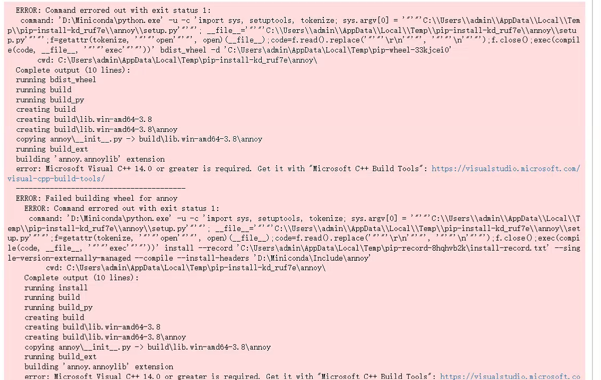

# Frequently asked questions

## Is a TensorFlow version planned?

Torch-RecHub uses PyTorch. There are currently no plans for a TensorFlow version.

## Why is the example AUC low or unstable?

The bundled datasets are small samples. Changing just a few validation records can noticeably change the AUC. On a first run, check that training finishes and produces predictions. To compare two models, use a full dataset and the same training, validation and test splits for both. [Ranking datasets](https://github.com/datawhalechina/torch-rechub/tree/main/examples/ranking) · [Retrieval datasets](https://github.com/datawhalechina/torch-rechub/tree/main/examples/matching)

## What if Annoy fails to install on Windows?

Install the Annoy extra in the Python environment you are using.

```bash
python -m pip install "torch-rechub[annoy]"
```

If no wheel is available for your Python version, pip builds Annoy from source. If you see `Microsoft Visual C++ 14.0 or greater is required`, install Microsoft C++ Build Tools, reopen the terminal and rerun the command. [Microsoft C++ Build Tools](https://visualstudio.microsoft.com/visual-cpp-build-tools/)



## What do I need to install for Annoy alone?

The installation command above is enough. `builder_factory("annoy", d=64)` uses a local index. A server connection is required only if you choose Milvus.

## Why does fit() report a missing model directory?

With `CTRTrainer`, `MatchTrainer` or `MTLTrainer`, create the directory named by `model_path` before training. This example saves a ranker under `saved/deepfm`.

```python
import os
from torch_rechub.trainers import CTRTrainer

os.makedirs("saved/deepfm", exist_ok=True)
trainer = CTRTrainer(model, model_path="saved/deepfm")
trainer.fit(train_dataloader, val_dataloader)
```

## Why does an example fail to find its data when I run it from another directory?

Some scripts use relative paths such as `./data/...`. Python resolves these from the working directory where you launched the command. For a ranking example, switch to `examples/ranking` first. If the script accepts `--dataset_path`, you can also supply an absolute path.

## Can multiple models use the same feature objects?

Two independent models can read the same `item_id` column. Create a fresh `SparseFeature` or `SequenceFeature` for each model. Passing the same feature object twice gives both models the same embedding table. To share a table intentionally between historical and target items within one model, use `shared_with` to name the item feature. [Features and embedding tables](/core/features#feature-instances-and-embedding-ownership)
