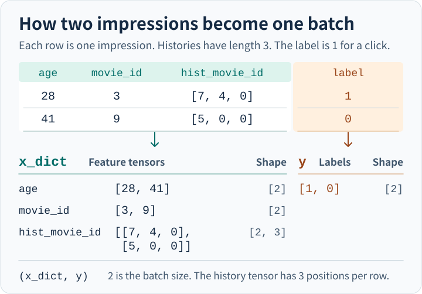

# Loading data

A ranking example contains a set of features and a label. Encode categories such as cities and movies as integers, then pad the histories in a batch to a common length. The DataLoader can now pass the examples to the trainer. [Feature definitions](/core/features)



## Datasets

### TorchDataset

`dataset[i]` returns the features and label for row `i`. The keys of `x` are feature names. The value at index `i` in every column must belong to the same record as `y[i]`.

```python
from torch_rechub.utils.data import TorchDataset

# x can be a DataFrame or a mapping from feature names to arrays or tensors.
dataset = TorchDataset(x, y)
```

If you pass a DataFrame, its columns must support indexing by row numbers starting at zero. A split may retain the original row index. Call `reset_index(drop=True)` or convert the columns to arrays first.

### PredictDataset

When you compute user or item embeddings, you often have only the features. `PredictDataset` returns a dictionary of features for one row.

```python
from torch_rechub.utils.data import PredictDataset

# A dataset for inference
dataset = PredictDataset(x)
```

## Data generators

### DataGenerator

`DataGenerator` can randomly split your features and labels into three sets. The two fractions below set aside rows for training and validation. The remaining rows go to the test set.

```python
from torch_rechub.utils.data import DataGenerator

# Create the data generator.
dg = DataGenerator(x, y)
# Create the data loaders.
train_dl, val_dl, test_dl = dg.generate_dataloader(
    split_ratio=[0.7, 0.1],  # 70% for training, 10% for validation and the remaining 20% for testing
    batch_size=256,           # Examples per batch
    num_workers=8             # Number of data-loading worker processes
)
```

If you have already split the data by time or business rules, construct `dg` with the training set. Pass the validation and test features and labels separately.

```python
train_dl, val_dl, test_dl = dg.generate_dataloader(
    x_val=x_val,
    y_val=y_val,
    x_test=x_test,
    y_test=y_test,
    batch_size=256,
)
```

The `split_ratio` option calls `torch.utils.data.random_split`. To reproduce the split, set `torch.manual_seed(...)` before creating the DataLoaders.

### MatchDataGenerator

Two-tower retrieval uses three loaders. `train_dl` supplies training examples. `test_dl` reads the user features in test-user order, and `item_dl` reads the item features in catalog order. Keeping these last two orders intact lets you map each output embedding back to its user or movie.

```python
from torch_rechub.utils.data import MatchDataGenerator

# Create the retrieval data generator.
dg = MatchDataGenerator(x, y)
# Create the data loaders.
train_dl, test_dl, item_dl = dg.generate_dataloader(
    x_test_user=x_test_user,  # Features for test users
    x_all_item=x_all_item,    # Features for the item catalog
    batch_size=256,           # Examples per batch
    num_workers=8             # Number of data-loading worker processes
)
```

## Utilities

### get_auto_embedding_dim

Choose an embedding width based on the number of categories.

```python
from torch_rechub.utils.data import get_auto_embedding_dim

# Choose an embedding width from the number of categories.
embed_dim = get_auto_embedding_dim(num_classes=1000)
```

`num_classes` is the category count. The returned width is `int(np.floor(6 * np.pow(num_classes, 0.25)))`.

### get_loss_func

Select the loss for a classification or regression task.

```python
from torch_rechub.utils.data import get_loss_func

# Binary classification loss
loss_func = get_loss_func(task_type="classification")
# Regression loss
loss_func = get_loss_func(task_type="regression")
```

- `task_type="classification"` returns `torch.nn.BCELoss`, which expects predicted probabilities in `[0, 1]`. Apply sigmoid first if your model returns logits.
- `task_type="regression"` returns `torch.nn.MSELoss`.

## Sequence data

`SequenceDataGenerator` prepares next-item examples for HSTU and HLLM. Its four NumPy arrays must have the same length along the first dimension. Each batch yields `(seq_tokens, seq_positions, seq_time_diffs, targets)`.

```python
from torch_rechub.utils.data import SequenceDataGenerator

generator = SequenceDataGenerator(
    seq_tokens,
    seq_positions,
    targets,
    seq_time_diffs,
)

# Already split: the return value is a one-element tuple.
train_dl = generator.generate_dataloader(
    batch_size=32,
    num_workers=0,
)[0]

# For an automatic split, pass three proportions that add up to 1.
train_dl, val_dl, test_dl = generator.generate_dataloader(
    batch_size=32,
    split_ratio=(0.7, 0.1, 0.2),
)
```

## Streaming Parquet data

If your training data is already in Parquet files, read it one batch at a time. For example, you can give `ParquetIterableDataset` the `part-*.parquet` files written by Spark and skip collecting the entire table on one machine with `toPandas()`.

### Install the dependency

Install the `bigdata` extra to read Parquet.

```bash
python -m pip install "torch-rechub[bigdata]"
```

### ParquetIterableDataset

The dataset below reads up to 1,024 rows at a time. Each dictionary it yields is already a batch, so set `batch_size=None` on the outer DataLoader. `split_label` separates the `label` column to produce the `(feature_dict, labels)` pair the ranking trainer expects.

```python
from torch.utils.data import DataLoader
from torch_rechub.data.dataset import ParquetIterableDataset

# Create a streaming dataset.
dataset = ParquetIterableDataset(
    ["/data/train1.parquet", "/data/train2.parquet"],
    columns=["user_id", "item_id", "label"],  # Optional subset of columns to read
    batch_size=1024,  # Maximum rows per batch
)

# The dataset yields a batch at a time. Separate the label from the model inputs.
def split_label(batch):
    x = {name: value for name, value in batch.items() if name != "label"}
    return x, batch["label"]

loader = DataLoader(dataset, batch_size=None, collate_fn=split_label)
```

Pass `loader` to `CTRTrainer.fit` to start training. To compute validation AUC after each epoch, use `DataGenerator` to prepare a validation loader with a defined length and call `trainer.fit(loader, val_dl)`. Use the same feature names and label meanings in both datasets. On Windows, define `split_label` at module level so worker processes can import it.

- `file_paths` lists the Parquet files to read.
- `columns` selects which columns to read. The default, `None`, reads them all.
- `batch_size` sets the maximum rows per batch and defaults to 1,024.

Multiple workers divide the files among themselves. With only one file, adding workers does not split that file into smaller pieces.

### Read files written by Spark

```python
# Write the files in Spark.
# df.write.parquet("/data/train.parquet")

# Read the files in PyTorch.
import glob
from torch.utils.data import DataLoader
from torch_rechub.data.dataset import ParquetIterableDataset

file_paths = glob.glob("/data/train.parquet/*.parquet")
dataset = ParquetIterableDataset(file_paths, batch_size=2048)
loader = DataLoader(dataset, batch_size=None, num_workers=8)
```

### Supported data types

| Parquet / Arrow type | PyTorch output |
| --- | --- |
| int8/16/32/64 | torch.float32 |
| float32/64 | torch.float32 |
| boolean | torch.float32 |
| list/array | 2D torch.Tensor |

Array columns, such as Spark's `Array<Float>`, must have the same length in every row. Unequal lengths raise `ValueError`.

The converter does not support Arrow string columns. Encode categories as numeric IDs before writing them to Parquet. All supported scalar columns, including integer IDs, become `torch.float32`, and the embedding layer casts its inputs back to integer indices. Since `float32` cannot represent every integer above `2^24` exactly, map large external IDs to compact, consecutive indices first.

For a complete ranking example, see [Prepare the Criteo inputs](/guide/quick_start#criteo-input). To build histories and retrieval examples from interaction records, see the [MovieLens retrieval tutorial](/tutorials/retrieval).
