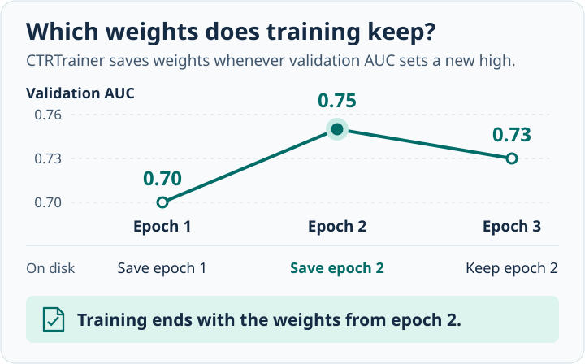

# Training and evaluation

Use `CTRTrainer` with a ranker such as DeepFM to estimate click probabilities. With a two-tower model such as DSSM, `MatchTrainer` can compute user and item embeddings separately. Use `MTLTrainer` when each example has several targets. HSTU and HLLM use `SeqTrainer` to predict the next item in a sequence.



## Trainers

Before using `CTRTrainer`, `MatchTrainer` or `MTLTrainer`, create the directory specified by `model_path`. For a ranking model, `fit(train_dl, val_dl)` checks validation AUC after each epoch. Whenever AUC exceeds its previous best, the trainer writes the weights to `model.pth`. If training stops unexpectedly in a later epoch, that checkpoint is already on disk. When `fit` finishes normally, `trainer.model` holds the weights from the best validation epoch. With only `train_dl`, the ranking trainer saves the final epoch instead.

To print the loss and learning rate for every batch, call `fit(train_dl, val_dl, log_interval=1)`. The ranking, retrieval and multi-task trainers all accept this argument. Use `device="cuda:0"` for a single GPU. For CUDA devices 0 and 1 on the same machine, pass `device="cuda:0", gpus=[0, 1]`.

### CTRTrainer

Start with [Prepare the Criteo inputs](/guide/quick_start#criteo-input) and keep the feature definitions and all three DataLoaders. The example updates the weights on `train_dl`, selects a checkpoint on `val_dl` and uses `test_dl` only for the final AUC.

```python
import os

from torch_rechub.trainers import CTRTrainer
from torch_rechub.models.ranking import DeepFM

# Build the model.
model = DeepFM(deep_features=dense_feas + sparse_feas, fm_features=sparse_feas, mlp_params={"dims": [256, 128], "dropout": 0.2})

# Create the trainer.
trainer = CTRTrainer(
    model=model,
    optimizer_params={"lr": 0.001, "weight_decay": 0.0001},
    n_epoch=50,
    earlystop_patience=10,
    device="cpu",
    model_path="saved/deepfm"
)

# Train the model.
os.makedirs("saved/deepfm", exist_ok=True)
trainer.fit(train_dl, val_dl)

# Evaluate on the test set.
auc = trainer.evaluate(trainer.model, test_dl)

# Export the model to ONNX.
example_batch, _ = next(iter(test_dl))
trainer.export_onnx("deepfm.onnx", dummy_input=example_batch)

# Draw the model architecture.
trainer.visualization(save_path="deepfm_architecture.pdf")
```

`n_epoch` is the maximum number of epochs. `earlystop_patience` is how many consecutive validation checks can pass without improvement before training stops. The example allows up to 50 epochs with a patience of 10. `optimizer_params` configures the optimizer, which defaults to `torch.optim.Adam`. If the model's `forward` returns both predictions and an auxiliary loss, set `loss_mode=False`.

### MatchTrainer

DSSM trains a user tower and an item tower. At inference time you can precompute the catalog vectors and update user vectors as needed, so each tower can have its own ONNX file.

```python
import os

from torch_rechub.trainers import MatchTrainer
from torch_rechub.models.matching import DSSM

# Build the model.
model = DSSM(user_features=user_features, item_features=item_features, temperature=1.0,  # Scale similarities during in-batch training.
             user_params={"dims": [256, 128, 64]}, item_params={"dims": [256, 128, 64]})

# Create the trainer.
trainer = MatchTrainer(
    model=model,
    mode=0,  # 0: point-wise, 1: pair-wise, 2: list-wise
    optimizer_params={"lr": 0.001},
    n_epoch=50,
    device="cuda:0",
    model_path="saved/dssm"
)

# Train the model.
os.makedirs("saved/dssm", exist_ok=True)
trainer.fit(train_dataloader)

# Export the user tower to ONNX.
trainer.export_onnx("user_tower.onnx", mode="user")

# Export the item tower to ONNX.
trainer.export_onnx("item_tower.onnx", mode="item")
```

Choose the training data format to match `mode`. With `mode=0`, each user–item pair has a binary label. With `mode=1`, training compares a positive and a negative item. With `mode=2`, the model selects the positive item from a list of candidates.

For DSSM in-batch training, keep only positive interactions in the training set and set `in_batch_neg=True`. By default, items from the other rows in the batch act as negatives. Use `in_batch_neg_ratio` to limit the number of negatives for each positive, or `hard_negative=True` to select high-scoring negatives. [Retrieval tutorial](/tutorials/retrieval)

### MTLTrainer

This MMOE model has two classification tasks. The entries in `task_types`, the label columns and the model outputs must all follow the same task order so that the trainer applies the right loss to each column.

```python
import os

from torch_rechub.trainers import MTLTrainer
from torch_rechub.models.multi_task import MMOE

# Build the model.
model = MMOE(features=features, task_types=["classification", "classification"], n_expert=8,
             expert_params={"dims": [32,16]}, tower_params_list=[{"dims": [32, 16]}, {"dims": [32, 16]}])

# Create the trainer.
trainer = MTLTrainer(
    model=model,
    task_types=["classification", "classification"],
    optimizer_params={"lr": 0.001},
    adaptive_params={"method": "uwl"},  # Learn task weights during training.
    n_epoch=50,
    earlystop_taskid=0,  # Index of the task monitored for early stopping
    device="cuda:0",
    model_path="saved/mmoe"
)

# Train the model.
os.makedirs("saved/mmoe", exist_ok=True)
trainer.fit(train_dataloader, val_dataloader)

# Export the model to ONNX.
trainer.export_onnx("mmoe.onnx")
```

With `adaptive_params=None`, the trainer averages task losses with equal weights. The example uses `{"method": "uwl"}` to learn those weights during training.

Early stopping monitors one task. `earlystop_taskid=0` selects the first column. For tasks `["classification", "regression"]`, set `earlystop_taskid=1, earlystop_mode="min"` to choose a checkpoint when the second task's MSE decreases. [Multi-task tutorial](/tutorials/pipeline)

### SeqTrainer

Each HSTU or HLLM batch contains `(seq_tokens, seq_positions, seq_time_diffs, targets)`. Here `evaluate(test_dataloader)` returns the average loss and top-1 accuracy, the fraction of predictions whose highest-scoring item matches the target.

```python
import os

from torch_rechub.trainers import SeqTrainer

os.makedirs("saved/hstu", exist_ok=True)
trainer = SeqTrainer(
    model=model,
    optimizer_params={"lr": 1e-3, "weight_decay": 1e-5},
    n_epoch=10,
    device="cpu",
    model_path="saved/hstu",
    loss_type="cross_entropy",  # On one device, use "sampled_softmax" to limit the number of training candidates.
)

history = trainer.fit(train_dataloader, val_dataloader)
test_loss, top1_accuracy = trainer.evaluate(test_dataloader)
trainer.export_onnx("hstu.onnx", vocab_size=model.vocab_size)
```

HSTU and HLLM derive positions internally, so `SeqTrainer` does not use `seq_positions` from the batch. With `loss_type="cross_entropy"`, the loss ignores token `0` by default. Reserve that ID for padding when preparing the data.

## Track experiments and draw model diagrams

Install `tracking` if you want to save training curves. Model diagrams and ONNX export use the `visualization` and `onnx` extras, respectively.

```bash
python -m pip install "torch-rechub[tracking]"
python -m pip install "torch-rechub[visualization]"
python -m pip install "torch-rechub[onnx]"
```

The example records each epoch's loss and validation metrics in both W&B and local TensorBoard logs. To use just one logger, pass that instance to `model_logger`. By default, training progress is printed in the terminal.

```python
from torch_rechub.basic.tracking import WandbLogger, TensorBoardXLogger
from torch_rechub.trainers import CTRTrainer

wb = WandbLogger(project="rechub-demo", name="deepfm")
tb = TensorBoardXLogger(log_dir="./runs/deepfm")

trainer = CTRTrainer(model, model_logger=[wb, tb])
trainer.fit(train_dataloader, val_dataloader)
```

## Evaluation metrics

Import the metrics from `torch_rechub.basic.metric`.

```python
from torch_rechub.basic.metric import (
    auc_score,
    coverage_score,
    diversity_score,
    gauc_score,
    log_loss,
    novelty_score,
    topk_metrics,
)

auc = auc_score(y_true, y_score)
gauc = gauc_score(y_true, y_score, user_ids)
ranking = topk_metrics(ground_truth, recommendations, topKs=[5, 10])
diversity = diversity_score(recommendations, item_embeddings, topKs=[10])
coverage = coverage_score(recommendations, all_item_ids, topKs=[10])
novelty = novelty_score(recommendations, item_popularity, topKs=[10])
```

- `auc_score` and `log_loss` take per-example labels and predicted scores and return floating-point values. Higher AUC and lower log loss are better.
- `gauc_score` computes AUC per user, skipping users whose labels all belong to one class. Supply `weights={user_id: weight}` for custom weighting. If no user with positive weight has both label classes, it raises `ValueError`.
- `topk_metrics` computes NDCG, MRR, Recall, Hit and Precision. Both `ground_truth` and `recommendations` are dictionaries shaped like `{user_id: [item_id, ...]}`. Give each user at least `max(topKs)` recommendations.
- `diversity_score` measures differences within the list, `coverage_score` measures how much of the catalog appears in recommendations, and `novelty_score` measures the average self-information of the recommended items. Larger values indicate greater diversity, coverage or novelty, respectively.

`topk_metrics` and the diversity, coverage and novelty functions return formatted results ready to print. For example, `ranking["Recall"]` might be `["Recall@10: 0.1234"]`, a list of strings. `ndcg_score`, `hit_score`, `mrr_score`, `recall_score` and `precision_score` also return lists of formatted strings.

## Callbacks

### EarlyStopper

Use the default `mode="max"` to monitor AUC, or `mode="min"` for loss or MSE. In a standard trainer, set `earlystop_patience`. For a custom training loop, see how to record the best score and restore its weights in [Callbacks](/tools/callbacks).

## Loss functions

### RegularizationLoss

Use `embedding_l1` and `embedding_l2` for embedding weights and `dense_l1` and `dense_l2` for fully connected layers. The ranking, retrieval and multi-task trainers accept these coefficients in `regularization_params`.

```python
from torch_rechub.basic.loss_func import RegularizationLoss

# Configure the regularization loss.
reg_loss_fn = RegularizationLoss(
    embedding_l1=0.0,  # L1 coefficient for embeddings
    embedding_l2=0.0001,  # L2 coefficient for embeddings
    dense_l1=0.0,  # L1 coefficient for dense layers
    dense_l2=0.0001  # L2 coefficient for dense layers
)
```

### BPRLoss

BPR compares two items for the same user. `pos_score` is the score for the positive item, and `neg_score` is the score for the negative item. The loss encourages the model to rank the positive item higher.

```python
from torch_rechub.basic.loss_func import BPRLoss

# Create the BPR loss.
bpr_loss = BPRLoss()

# Compare the positive and negative scores.
loss = bpr_loss(pos_score, neg_score)
```
