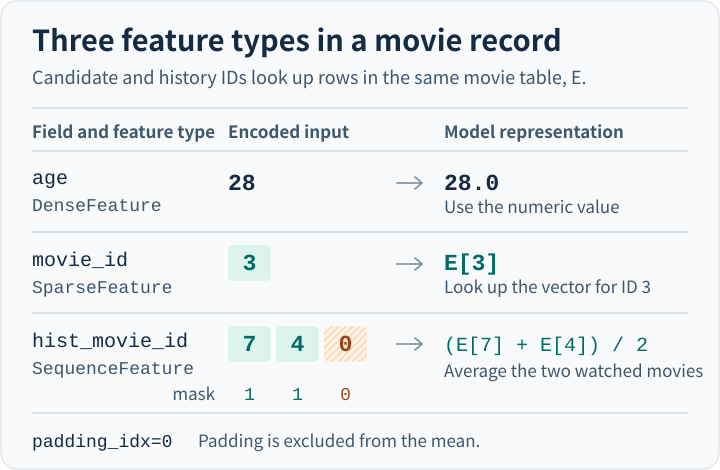

# Feature definitions

Look at what one row contains. Age is a number, a city is a category, and a viewing history is a sequence of movie IDs. Describe them with `DenseFeature`, `SparseFeature` and `SequenceFeature`, respectively. Each feature's `name` must match its key in the input dictionary.



## DenseFeature

Each row has one value for `age`, so its `embed_dim` is 1. For a column that already holds an eight-dimensional numeric vector, set `embed_dim=8`.

```python
from torch_rechub.basic.features import DenseFeature

# A numeric feature
dense_feature = DenseFeature(name="age", embed_dim=1)
```

## SparseFeature

First map each city name to an integer in your vocabulary. The integer selects a row in an embedding table. The example below has 100 rows, accepts IDs from 0 to 99 and returns a 16-dimensional vector for each lookup.

```python
from torch_rechub.basic.features import SparseFeature

# A categorical feature
sparse_feature = SparseFeature(
    name="city",
    vocab_size=100,  # Number of rows in the vocabulary
    embed_dim=16,     # Width of each embedding vector
    shared_with=None  # Set a feature name here to share its embedding table.
)
```

If you omit `embed_dim`, the framework chooses a width based on the vocabulary size. Include a row in `vocab_size` for any reserved unknown-category ID.

## SequenceFeature

Several IDs in one example can look up vectors in the same table. Here, `user_history` contains the IDs of movies a user has watched. Each movie has a 32-dimensional vector. With `pooling="mean"`, the model averages the valid positions, so users can have different numbers of watched movies.

```python
from torch_rechub.basic.features import SequenceFeature

# A sequence feature
sequence_feature = SequenceFeature(
    name="user_history",
    vocab_size=10000,  # Number of rows in the vocabulary
    embed_dim=32,       # Width of each embedding vector
    pooling="mean",      # Pooling options: mean, sum, concat
    padding_idx=0,       # Use 0 to pad the sequence.
)
```

Use `sum` to add the vectors at valid positions. If the next layer needs individual positions, as an attention layer does, use `concat` to keep the sequence dimension.

## Model inputs

Encode category strings as integers and pad histories in the same batch to a common length before passing them to the model.

| Feature | Typical shape | Values |
| --- | --- | --- |
| `DenseFeature` | `(batch_size,)` or `(batch_size, embed_dim)` | Values convertible to floating point |
| `SparseFeature` | `(batch_size,)` | Integer indices in `[0, vocab_size)` |
| `SequenceFeature` | `(batch_size, seq_len)` | Integer indices, padded to the same length |

If you pad histories with `0`, set `padding_idx=0` on the history feature. Otherwise `InputMask` checks for `-1` by default, so the zero-padded positions count toward the mean.

## Initialize an embedding table

The default initializer is `RandomNormal(0, 0.0001)`. You can pass `RandomUniform()`, `XavierNormal()` or `XavierUniform()` as the `initializer`. If you already have item vectors, load them with `Pretrained`. Row `i` in the matrix must correspond to item `i` in your vocabulary.

```python
import torch

from torch_rechub.basic.features import SparseFeature
from torch_rechub.basic.initializers import XavierUniform, Pretrained

random_feature = SparseFeature(
    name="item_id",
    vocab_size=1000,
    embed_dim=32,
    padding_idx=0,
    initializer=XavierUniform(gain=1.0),
)

weights = torch.randn(1000, 32)
pretrained_feature = SparseFeature(
    name="pretrained_item_id",
    vocab_size=1000,
    embed_dim=32,
    padding_idx=0,
    initializer=Pretrained(weights, freeze=False),
)
```

Here `weights` has 1,000 rows and 32 columns, matching `vocab_size` and `embed_dim`. Pass `freeze=False` to fine-tune the vectors, or keep the default `freeze=True` to hold them fixed. The built-in random initializers zero the padding row. With pretrained embeddings, that row starts with the values in your matrix.

## Give independent models their own weights {#feature-instances-and-embedding-ownership}

Two models can both have a feature named `city`. What matters is which Python object each model receives. A `SparseFeature` or `SequenceFeature` stores the embedding table the first time it creates one. Both layers below receive the same `features[0]` object, so updating the city vectors in one layer also changes what the other layer looks up.

```python
from torch_rechub.basic.features import SparseFeature
from torch_rechub.basic.layers import EmbeddingLayer

features = [SparseFeature(name="city", vocab_size=100, embed_dim=16)]

embedding_a = EmbeddingLayer(features)
embedding_b = EmbeddingLayer(features)

assert embedding_a.embed_dict["city"] is embedding_b.embed_dict["city"]
```

To compare models independently, call `build_features()` each time you create a model. The features have the same name but each gets its own table.

```python
def build_features():
    return [SparseFeature(name="city", vocab_size=100, embed_dim=16)]

embedding_a = EmbeddingLayer(build_features())
embedding_b = EmbeddingLayer(build_features())

assert embedding_a.embed_dict["city"] is not embedding_b.embed_dict["city"]
```

`features.copy()` copies the outer list. Both lists still contain the same `city` feature object.

## Share a movie embedding between candidates and histories

The same movie can be today's candidate or part of the user's history. Suppose `M42` has ID `3` during training. At prediction time, reuse that vocabulary and map new movies to `0`. In the example below, `movie_id` owns the table and `hist_movie_id` uses it via `shared_with="movie_id"`. ID `3` retrieves the same vector in either field.

```python
from torch_rechub.basic.features import SparseFeature, SequenceFeature
from torch_rechub.basic.layers import EmbeddingLayer

item = SparseFeature("movie_id", vocab_size=100, embed_dim=16, padding_idx=0)
history = SequenceFeature("hist_movie_id", vocab_size=100, embed_dim=16,
                          pooling="mean", shared_with="movie_id", padding_idx=0)
embedding = EmbeddingLayer([item, history])
```

The two `padding_idx=0` settings do different jobs. On `item`, the setting reserves row 0 in the shared table. On `history`, it tells pooling which positions to skip. For `[3, 0, 0]`, only movie `3` contributes to the mean. Other fields can use `0` as a real category if their own encoding calls for it.

When creating the `EmbeddingLayer`, include both the feature that owns the table and the one that refers to it. Sparse embeddings that the layer concatenates must have the same width.
