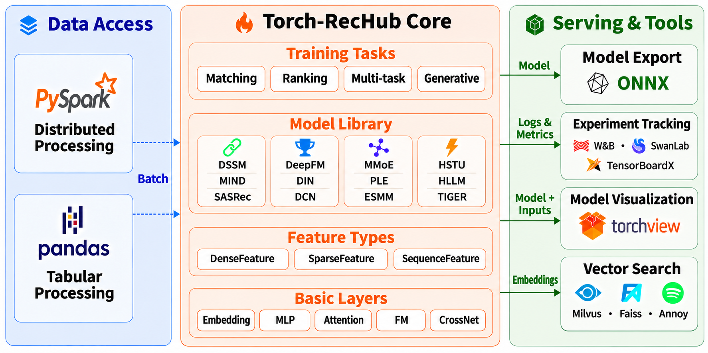

# Introducing Torch-RecHub

Torch-RecHub implements retrieval, ranking, multi-task and generative recommendation models in PyTorch. A good first experiment is to train DeepFM on the bundled ad-click sample and see how it turns one ad impression into a click probability. [Quick start](/guide/quick_start)

## Framework architecture

When you bring your own data, three parts of the code matter first. Feature definitions tell the model how to read each column. For example, `item_id` looks up a row in an embedding table, while `price` goes in as a number. The model's `forward` method combines those inputs. The trainer reads batches, computes validation metrics and saves weights. To change how a model scores an example, start with its `forward` method. [Feature definitions](/core/features) · [Training and evaluation](/core/evaluation)

## Choose a model for your task

| What do you need to do? | Where to start |
| --- | --- |
| Select a short list of candidates for each user from a large catalog | [Retrieve candidates with DSSM](/tutorials/retrieval) |
| Order existing candidates by how likely the user is to click | [Rank candidates with DeepFM](/tutorials/ctr) |
| Learn from both click and purchase labels on the same impression | [Multi-task learning](/tutorials/pipeline) |
| Predict the next item from a sequence of timestamped interactions | [Sequential and generative models](/models/generative) |

You can run the introductory examples on a CPU. For an NVIDIA GPU, AMD GPU or Huawei Ascend NPU, install the PyTorch build that matches the device. After training, you can export a ranker to ONNX for inference. With a two-tower model, you can also compute user and item vectors separately for retrieval. [Installation](/guide/install) · [Serving example](/serving/demo)
