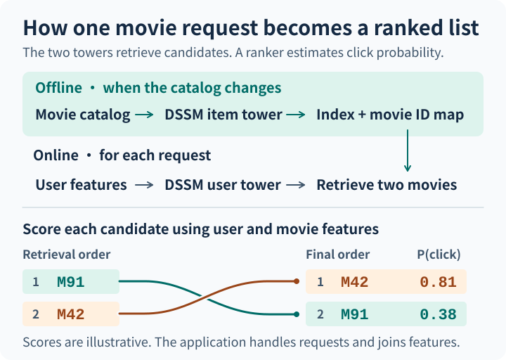

# Serving trained models

DeepFM scores a user–item pair. To serve it, keep its feature vocabularies and normalization parameters alongside its weights. DSSM retrieves candidates from a catalog. Compute the item vectors ahead of time, then save the search index together with the item IDs in the same order.

You can try both tasks locally. Compare the PyTorch and ONNX scores for one record, or use a user vector to retrieve movie IDs. [Make a prediction with a trained model](/serving/demo)

## How a recommendation request is served



## Quick start

### 1. Export to ONNX

A ranking model can be exported in one piece. For two-tower retrieval, export the towers separately so an offline job can use the item tower to build the index and each new request only needs the user tower. Here, `ctr_trainer` and `match_trainer` refer to the trainers from the completed examples. [Export options](/serving/onnx)

```python
# Continue with the ranking trainer that holds the best validation weights.
ctr_trainer.export_onnx("model_fp32.onnx")

# Export each tower separately.
# Use the matching trainer from the completed retrieval example.
match_trainer.export_onnx("user_tower.onnx", mode="user")
match_trainer.export_onnx("item_tower.onnx", mode="item")
```

### 2. Quantize the model

Keep the original FP32 file. Try INT8 for a CPU or FP16 for a GPU that supports half precision. Compare scores and latency against FP32 on the same real inputs before choosing a model to serve.

```python
from torch_rechub.utils.quantization import quantize_model

# Dynamic INT8 quantization for CPU inference
quantize_model("model_fp32.onnx", "model_int8.onnx", mode="int8")

# FP16 conversion for a GPU with half-precision support
quantize_model("model_fp32.onnx", "model_fp16.onnx", mode="fp16")
```

### 3. Search an item index

Build a Faiss index from item vectors, then query it for the top 10 candidates for each user vector. The returned `ids` are row numbers. Look them up in the item ID table you saved when building the index. [Vector indexes](/serving/vector_index)

```bash
pip install "torch-rechub[faiss]"
```

```python
from torch_rechub.serving import builder_factory

# Build a Faiss index.
builder = builder_factory("faiss", index_type="HNSW", metric="IP")

with builder.from_embeddings(item_embeddings) as indexer:
    ids, scores = indexer.query(user_embeddings, top_k=10)
    indexer.save("item.index")
```

## Connect the model to your service

When a ranking request arrives, transform the candidate features using the saved training vocabularies and normalization parameters. Pass them to ONNX Runtime and return the candidates in score order.

For retrieval, run the item tower when updating the catalog offline. Write the index and its ordered ID table together. At request time, run the user tower once, query the index and return the candidate IDs. Torch-RecHub provides the export and search interfaces. Your application handles incoming requests.
