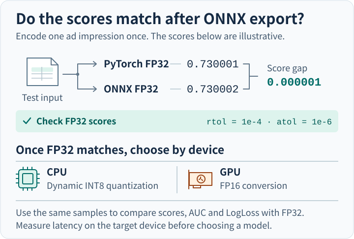

# ONNX export and quantization

Export a trained model as a `.onnx` file to run predictions with ONNX Runtime. Start with FP32 and compare its score against PyTorch for one test record. Once the scores agree, try INT8 or FP16 on the device that will serve the model. [Check both scores on one record](/serving/demo)



## Install the dependencies

Install the ONNX extra in the environment you use for export.

```bash
pip install "torch-rechub[onnx]"
```

This extra includes the CPU build of ONNX Runtime and the FP16 conversion tools. For NVIDIA GPU inference, use an `onnxruntime-gpu` build that matches your CUDA installation and driver. Check that `onnxruntime.get_available_providers()` includes `CUDAExecutionProvider`.

## Export with the trainer

Each `trainer` below comes from the corresponding training example. By default, the exporter builds sample inputs from the feature definitions. If you have a test batch, pass it as `dummy_input` to match the actual input shapes. With a dynamic batch dimension, the exported model accepts one or more records per call.

### Export a click-through rate model

```python
from torch_rechub.trainers import CTRTrainer

# ... trainer.fit(train_dl, val_dl)
trainer.export_onnx("deepfm.onnx")
```

### Export a retrieval model or its towers

If you can precompute item vectors, export the two towers separately. The offline index builder runs the item tower, and each new request runs the user tower. You can also export the complete model using the default `MatchTrainer` export mode.

```python
from torch_rechub.trainers import MatchTrainer

# Export the user tower to compute user embeddings.
trainer.export_onnx("user_tower.onnx", mode="user")

# Export the item tower to compute item embeddings.
trainer.export_onnx("item_tower.onnx", mode="item")
```

### Export a multi-task model

```python
from torch_rechub.trainers import MTLTrainer

trainer.export_onnx("mmoe.onnx")
```

### Pass options to the PyTorch exporter

Use `onnx_export_kwargs` to select the PyTorch exporter. Here, `dynamo=False` selects the legacy exporter. Options already set by Torch-RecHub cannot be repeated in this dictionary.

```python
trainer.export_onnx(
    "model.onnx",
    dynamic_batch=True,  # Allow a variable batch size.
    onnx_export_kwargs={
        "dynamo": False,  # Use the legacy exporter for this example.
    },
)
```

The wrapper sets `f`, `input_names`, `output_names`, `opset_version`, `do_constant_folding`, `verbose` and the automatically generated `dynamic_axes`. Passing one of these again in `onnx_export_kwargs` raises `ValueError`.

Start with the default exporter for most models. The CTR, matching and multi-task trainers first try Dynamo with `dynamic_shapes` for a variable batch size. If that fails, they fall back to the legacy exporter with `dynamic_axes`. The wrapper also uses the legacy exporter on PyTorch versions that lack the `dynamo` argument. For sequence models, `SeqTrainer` defaults to the legacy exporter when the batch size or sequence length varies. You can explicitly select Dynamo for fixed input shapes.

### Inspect the exported model

Open the `.onnx` file in Netron to see input names, data types and tensor shapes. Use these to build the input dictionary for ONNX Runtime. [Netron](https://netron.app/)

## Choose a lower-precision format

Choose the format for the machine that will run inference.

- **CPU.** Try `int8` for dynamic quantization of supported operators such as linear layers and matrix multiplication.
- **GPU with half-precision support.** Try `fp16` to reduce the size of floating-point weights. The speed depends on the hardware and the operators in the model.

Both modes work with standard single-file ONNX models. Models over 2 GB with external weights and GPU INT8 calibration require other tools. Both examples below start from the same `model_fp32.onnx`.

### 1. Dynamic INT8 quantization for CPU

```python
from torch_rechub.utils.quantization import quantize_model

quantize_model("model_fp32.onnx", "model_int8.onnx", mode="int8")
```

You can adjust how INT8 weights are represented with the following options.
- `per_channel=True` enables per-channel weight quantization.
- `reduce_range=True` reduces the range of integer values used for quantization.
- `weight_type` selects the quantized weight type, either `"qint8"` or `"quint8"`.

Existing scripts can still use `dynamic_int8` or `dynamic` as aliases for `int8`. Pass node filters to quantize only selected nodes.

**What if my script uses `optimize_model=True`?** ONNX Runtime removed this argument in version 1.16. If your model needs preprocessing, run ONNX Runtime's `quant_pre_process()` before quantization.

**What if a Dynamo-exported Gemm node has conflicting shapes?** With ONNX Runtime 1.18 or later, the conversion utility can clear duplicate shape information in memory and preserve the original ONNX file. With an older Runtime, re-export the model with `onnx_export_kwargs={"dynamo": False}` and quantize that file.

### 2. FP16 conversion for GPU

```python
from torch_rechub.utils.quantization import quantize_model

quantize_model("model_fp32.onnx", "model_fp16.onnx", mode="fp16")
```

The default, `keep_io_types=True`, keeps floating-point inputs and outputs in FP32, so callers can reuse the original inputs. Integer category IDs retain their type. If your caller will supply half-precision floating-point inputs, pass `keep_io_types=False` or the CLI flag `--no-keep-io-types`. Older scripts can still use the mode name `float16`.

## Run the examples and compare inference times

Run the following commands from the repository root and substitute your own model paths.

### Quantization script

```bash
python examples/serving/quantize_onnx.py --input model_fp32.onnx --output model_int8.onnx --mode int8
python examples/serving/quantize_onnx.py --input model_fp32.onnx --output model_fp16.onnx --mode fp16
```

### Inference benchmark

Compare file sizes and inference times for FP32, INT8 and FP16 models.

```bash
python examples/serving/benchmark_onnx_quantization.py --fp32 model_fp32.onnx --int8 model_int8.onnx --inputs batch.npz
python examples/serving/benchmark_onnx_quantization.py --fp32 model_fp32.onnx --fp16 model_fp16.onnx --inputs batch.npz --provider CUDAExecutionProvider
```

Use `batch.npz` to fix the inputs for the comparison. The keys must match the ONNX input names, as in `np.savez("batch.npz", user_id=user_ids, item_id=item_ids)`. For category IDs, masks or sequence lengths, use real values produced by the training preprocessing and preserve the type of each field. For models with only floating-point inputs, you can omit `--inputs` to use random inputs generated with a fixed seed.

The script feeds the same batch to each model. If FP16 conversion changed a floating-point input type, the script casts it as needed. GPU mode checks whether the CUDA provider is registered. The device used for each operator still depends on the model and Runtime.

The size reported is for the `.onnx` file alone. CPU operators use a single thread, and timings include input and output copies. After comparing speed, evaluate metrics such as ranking AUC and LogLoss on the same validation set before and after quantization.
