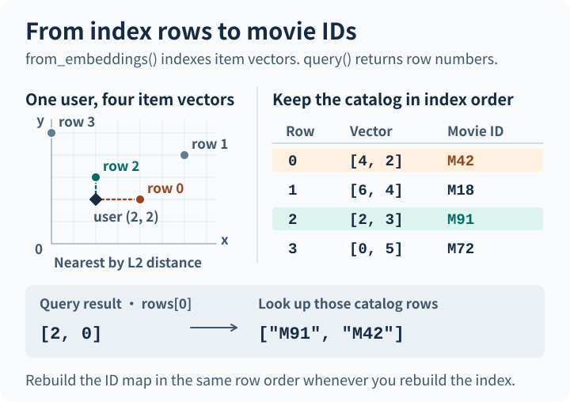

# Vector indexes

A two-tower model produces one vector per item. To find candidates for a user, query the index with the user's vector and retrieve the nearest items. Annoy, Faiss and Milvus all use `from_embeddings` to build the index and `query` to search it. They differ in where they run and how you save the index.



## Installation

The first example uses Faiss. In your current Python environment, run `pip install "torch-rechub[faiss]"`. For Annoy or Milvus, use the corresponding extra in the sections below.

## Quick start

Start with random 64-dimensional vectors for 1,000 items and 10 users. Each user requests 10 candidates, so both `ids` and `scores` have shape `[10, 10]`. For real retrieval, replace the random inputs with vectors from the item and user towers.

```python
import torch
from torch_rechub.serving import builder_factory

# Prepare the embeddings.
item_embeddings = torch.randn(1000, 64, dtype=torch.float32)  # 1,000 items, 64 dimensions
user_embeddings = torch.randn(10, 64, dtype=torch.float32)    # 10 users, 64 dimensions

# Choose the backend and build an index.
builder = builder_factory("faiss", index_type="Flat", metric="L2")

with builder.from_embeddings(item_embeddings) as indexer:
    # Retrieve the top K candidates.
    ids, scores = indexer.query(user_embeddings, top_k=10)
    # IDs are vector row numbers. Save an item ID table in the same order as item_embeddings.
    # Save the index.
    indexer.save("item.index")

# Reload the existing index.
with builder.from_index_file("item.index") as indexer:
    ids, scores = indexer.query(user_embeddings, top_k=10)
```

`ids[0]` contains the candidate row numbers for the first user. For example, row number 7 selects the eighth row you passed in `item_embeddings`. When you save the index, also save an ordered item ID table so you can convert the row numbers back to original IDs. [Recover movie IDs from search results](/serving/demo)

With Faiss and L2, `scores` contains squared Euclidean distances. Smaller values indicate closer items. With inner product (`IP`) or cosine similarity (`COSINE`), larger scores indicate greater similarity.

## How the interface works

### Builders and indexers

Configure the backend, dimension and distance metric on the `builder`. Open an index with `builder.from_embeddings(...)` and call `indexer.query(...)` inside the `with` block. Annoy and Faiss can save that index to a file and reopen it with `from_index_file(...)` in a later run.

### Factory function

```python
from torch_rechub.serving import builder_factory

builder = builder_factory(model, **builder_config)
```

| Parameter | Type | Description |
| ------------------ | ------ | ------------------------------------------------ |
| `model` | `str` | Backend name, one of `"annoy"`, `"faiss"` or `"milvus"` |
| `**builder_config` | `dict` | Options passed to the chosen builder |

---

## Annoy

Annoy is a good fit when you build the index in advance and deploy it as a local file. Annoy memory-maps the file when it loads it. [Annoy project](https://github.com/spotify/annoy)

### Backend dependency

```bash
pip install "torch-rechub[annoy]"
```

Annoy contains a C++ extension. If a prebuilt package is unavailable for your platform, install GCC or Clang on Linux or macOS, or Visual Studio Build Tools on Windows. [Windows installation FAQ](/community/faq)

### Parameters

```python
builder = builder_factory(
    "annoy",
    d=64,                    # Vector dimension (required)
    metric="angular",        # Distance metric
    n_trees=10,              # Number of trees
    threads=-1,              # Build threads
    searchk=-1,              # Nodes to inspect per search
)
```

| Parameter | Type | Default | Meaning |
| --------- | ----- | ----------- | --------------------------------------------------------------------- |
| `d` | `int` | Required | Vector dimension |
| `metric` | `str` | `"angular"` | Use `"angular"` for angular distance, `"euclidean"` for Euclidean distance, or `"dot"` for dot product |
| `n_trees` | `int` | `10` | Trees to build. More trees can improve recall but take longer to build. |
| `threads` | `int` | `-1` | Build threads. Use `-1` for all available cores. |
| `searchk` | `int` | `-1` | Nodes inspected per query. The default `-1` uses `n_trees * top_k`. |

### Example

```python
import torch
from torch_rechub.serving import builder_factory

item_embeddings = torch.randn(1000, 64, dtype=torch.float32)
user_embeddings = torch.randn(10, 64, dtype=torch.float32)

# With angular distance, smaller values indicate more similar items.
builder = builder_factory(
    "annoy",
    d=64,
    metric="angular",
    n_trees=50,
    searchk=100,
)

with builder.from_embeddings(item_embeddings) as indexer:
    ids, distances = indexer.query(user_embeddings, top_k=10)
    indexer.save("annoy.index")

print(f"Candidate item rows: {ids}")
print(f"Distances: {distances}")
```

---

## FAISS

Faiss supports exact search and approximate indexes that visit fewer candidates at query time. Torch-RecHub's `FaissBuilder` builds and queries indexes on the CPU. [Faiss project](https://github.com/facebookresearch/faiss)

### Backend dependency

```bash
pip install "torch-rechub[faiss]"
```

### Index types

| Index | Search method | When to try it |
| --- | --- | --- |
| `Flat` | Compare all item vectors | Establish exact results as a reference when measuring recall |
| `HNSW` | Visit neighbors in a graph | Reduce query time when the graph fits in memory |
| `IVF` | Cluster item vectors and search selected clusters | Search a larger catalog and tune the search range with `nprobe` |

### Parameters

#### Flat index

```python
builder = builder_factory(
    "faiss",
    index_type="Flat",       # Index type
    metric="L2",             # Distance metric
)
```

| Parameter | Type | Default | Meaning |
| ------------ | ----- | -------- | -------------------------------------------- |
| `index_type` | `str` | `"Flat"` | Index type |
| `metric` | `str` | `"L2"` | Use `"L2"` for Euclidean distance or `"IP"` for inner product |

#### HNSW index

```python
builder = builder_factory(
    "faiss",
    index_type="HNSW",
    metric="L2",
    m=32,                    # Maximum neighbors per node
    efSearch=50,             # Candidate nodes considered during search
)
```

| Parameter | Type | Default | Meaning |
| ---------- | ----- | ------ | -------------------------------------- |
| `m` | `int` | `32` | Maximum neighbors per node. Larger values can improve recall. |
| `efSearch` | `int` | `None` | Candidate nodes considered during search. Larger values trade query speed for recall. |

#### IVF index

```python
builder = builder_factory(
    "faiss",
    index_type="IVF",
    metric="L2",
    nlists=100,              # Number of cluster centers
    nprobe=10,               # Clusters visited per query
)
```

| Parameter | Type | Default | Meaning |
| -------- | ----- | ------ | --------------------------------------------- |
| `nlists` | `int` | `100` | Number of cluster centers. A starting range is `sqrt(n)` to `4*sqrt(n)` for `n` items. |
| `nprobe` | `int` | `None` | Number of clusters to visit. Larger values can improve recall at the cost of query time. |

### Example

```python
import torch
from torch_rechub.serving import builder_factory

item_embeddings = torch.randn(10000, 128, dtype=torch.float32)
user_embeddings = torch.randn(100, 128, dtype=torch.float32)

# Build an HNSW index.
builder = builder_factory(
    "faiss",
    index_type="HNSW",
    metric="IP",  # Inner product for normalized vectors
    m=32,
    efSearch=64,
)

with builder.from_embeddings(item_embeddings) as indexer:
    ids, distances = indexer.query(user_embeddings, top_k=20)
    indexer.save("faiss_hnsw.index")
```

---

## Milvus

If you have a running Milvus service, use the same `query` interface to try a server-side index. The example creates a temporary collection and deletes it when the `with` block ends. [Milvus project](https://milvus.io/)

### Client dependency and server setup

```bash
pip install "torch-rechub[milvus]"
```

The command above installs the Python client. If you do not have a server yet, start Milvus Standalone and check the connection before running the query example. [Milvus Standalone installation with Docker](https://milvus.io/docs/install_standalone-docker.md)

### Index types

| Index type | Search method | When to try it |
| ---------- | ------------ | -------------------- |
| `FLAT` | Exhaustive search | Exact results on small datasets |
| `HNSW` | Graph-based index | High recall on medium-sized datasets |
| `IVF_FLAT` | Inverted-file index | Larger datasets |

### Parameters

#### FLAT index

```python
builder = builder_factory(
    "milvus",
    d=64,                    # Vector dimension (required)
    index_type="FLAT",
    metric="COSINE",         # Default metric
)
```

| Parameter | Type | Default | Meaning |
| -------- | ----- | ------ | ------------------------------------ |
| `d` | `int` | Required | Vector dimension |
| `metric` | `str` | `"COSINE"` | Metric, one of `"L2"`, `"IP"` or `"COSINE"` |

#### HNSW index

```python
builder = builder_factory(
    "milvus",
    d=64,
    index_type="HNSW",
    metric="COSINE",
    m=30,                    # Maximum neighbors per node
    ef=50,                   # Candidate nodes considered during search
)
```

| Parameter | Type | Default | Meaning |
| ---- | ----- | ------ | -------------------- |
| `m` | `int` | `30` | Maximum neighbors per node |
| `ef` | `int` | `None` | Candidate nodes considered during search |

#### IVF_FLAT index

```python
builder = builder_factory(
    "milvus",
    d=64,
    index_type="IVF_FLAT",
    metric="IP",
    nlist=128,               # Number of cluster centers
    nprobe=16,               # Clusters visited per query
)
```

| Parameter | Type | Default | Meaning |
| -------- | ----- | ------ | ------------------ |
| `nlist` | `int` | `128` | Number of cluster centers |
| `nprobe` | `int` | `None` | Clusters visited per query |

### Example

```python
import torch
from torch_rechub.serving import builder_factory

item_embeddings = torch.randn(10000, 64, dtype=torch.float32)
user_embeddings = torch.randn(100, 64, dtype=torch.float32)

# Build an HNSW index on Milvus.
builder = builder_factory(
    "milvus",
    d=64,
    index_type="HNSW",
    metric="COSINE",
    m=32,
    ef=64,
)

with builder.from_embeddings(item_embeddings) as indexer:
    ids, distances = indexer.query(user_embeddings, top_k=10)
    # This backend does not support saving the index to a local file.
```

If you need to query the same collection later, create it and manage its lifetime with the Milvus client. This wrapper does not implement `save()` or `from_index_file()` for Milvus.

---

## Evaluate a retrieval model

Query the item index with the test users' vectors, map candidate rows back to original item IDs, then compare them with held-out interactions. Here each user has one vector. The input user table and item table must each follow the same row order as their respective embeddings. For MIND or ComiRec, query each interest vector separately, then merge the candidates for that user. [MIND multi-interest retrieval](/tutorials/models/matching/mind)

```python
import collections
import numpy as np
import pandas as pd
import torch
from torch_rechub.serving import builder_factory
from torch_rechub.basic.metric import topk_metrics

def match_evaluation(
    user_embedding: torch.Tensor,
    item_embedding: torch.Tensor,
    test_user: dict,
    all_item: dict,
    user_col: str = 'user_id',
    item_col: str = 'item_id',
    raw_id_maps: str = "./raw_id_maps.npy",
    topk: int = 10,
    backend: str = "faiss",
    **backend_kwargs,
):
    """
    Evaluate retrieval using a vector index.

    Args:
        user_embedding: User vectors (n_users, dim).
        item_embedding: Item vectors (n_items, dim).
        test_user: Test user data dictionary.
        all_item: Full item catalog dictionary.
        user_col: User ID column name.
        item_col: Item ID column name.
        raw_id_maps: Path to the ID mapping file.
        topk: Number of candidates to retrieve.
        backend: Search backend ("annoy", "faiss", "milvus").
        **backend_kwargs: Additional arguments for builder_factory.

    Returns:
        Dictionary of retrieval metrics.
    """
    print(f"Using {backend} to evaluate retrieval")

    # 1. Configure the index builder.
    dim = item_embedding.shape[1]

    if backend == "annoy":
        config = {"d": dim, "n_trees": 10}
    elif backend == "faiss":
        config = {"index_type": "Flat", "metric": "L2"}
    elif backend == "milvus":
        config = {"d": dim, "index_type": "FLAT", "metric": "L2"}
    else:
        raise ValueError(f"Unsupported backend: {backend}")
    # Caller options override defaults without repeating a keyword such as index_type.
    config.update(backend_kwargs)
    builder = builder_factory(backend, **config)

    # 2. Move vectors to the CPU.
    item_embedding = item_embedding.cpu().float()
    user_embedding = user_embedding.cpu().float()

    # 3. Load the original ID mappings.
    user_map, item_map = np.load(raw_id_maps, allow_pickle=True)

    # 4. Build and query the index.
    match_res = collections.defaultdict(dict)

    with builder.from_embeddings(item_embedding) as indexer:
        ids, distances = indexer.query(user_embedding, topk)
        ids_np = ids.numpy()

        for i, user_id in enumerate(test_user[user_col]):
            items_idx = ids_np[i]
            predicted_item_ids = all_item[item_col][items_idx]
            match_res[user_map[user_id]] = np.vectorize(item_map.get)(predicted_item_ids)

    # 5. Collect held-out items for each user.
    data = pd.DataFrame({user_col: test_user[user_col], item_col: test_user[item_col]})
    data[user_col] = data[user_col].map(user_map)
    data[item_col] = data[item_col].map(item_map)
    user_pos_item = data.groupby(user_col).agg(list).reset_index()
    ground_truth = dict(zip(user_pos_item[user_col], user_pos_item[item_col]))

    # 6. Compute retrieval metrics.
    out = topk_metrics(y_true=ground_truth, y_pred=match_res, topKs=[topk])
    return out


# Example call
# result = match_evaluation(
#     user_embedding, item_embedding, test_user, all_item,
#     topk=10, backend="faiss", index_type="HNSW", m=32
# )
```

---

## Choose a backend

Annoy and Faiss both support `save()` for a local index. The MovieLens tutorial shows an Annoy example from indexing to querying. Use Faiss if you want an exact reference or want to compare HNSW and IVF. If you already run Milvus, use the wrapper's temporary collection for offline evaluation and manage long-lived collections in your own service. [Retrieve original movie IDs](/serving/demo)

## API reference

### BaseBuilder

```python
class BaseBuilder(abc.ABC):
    def from_embeddings(self, embeddings: torch.Tensor) -> ContextManager[BaseIndexer]:
        """Build an index from embeddings."""

    def from_index_file(self, index_file: FilePath) -> ContextManager[BaseIndexer]:
        """Load an index from a file."""
```

### BaseIndexer

```python
class BaseIndexer(abc.ABC):
    def query(self, embeddings: torch.Tensor, top_k: int) -> tuple[torch.Tensor, torch.Tensor]:
        """
        Query the nearest neighbors.

        Args:
            embeddings: Query vectors (n, d).
            top_k: Number of neighbors per query.

        Returns:
            ids: Neighbor IDs (n, top_k).
            distances: Distances (n, top_k).
        """

    def save(self, file_path: FilePath) -> None:
        """Save the index to a file."""
```

Annoy and Faiss implement `from_index_file()` and `save()`. On the Milvus backend, these methods raise `NotImplementedError`.
