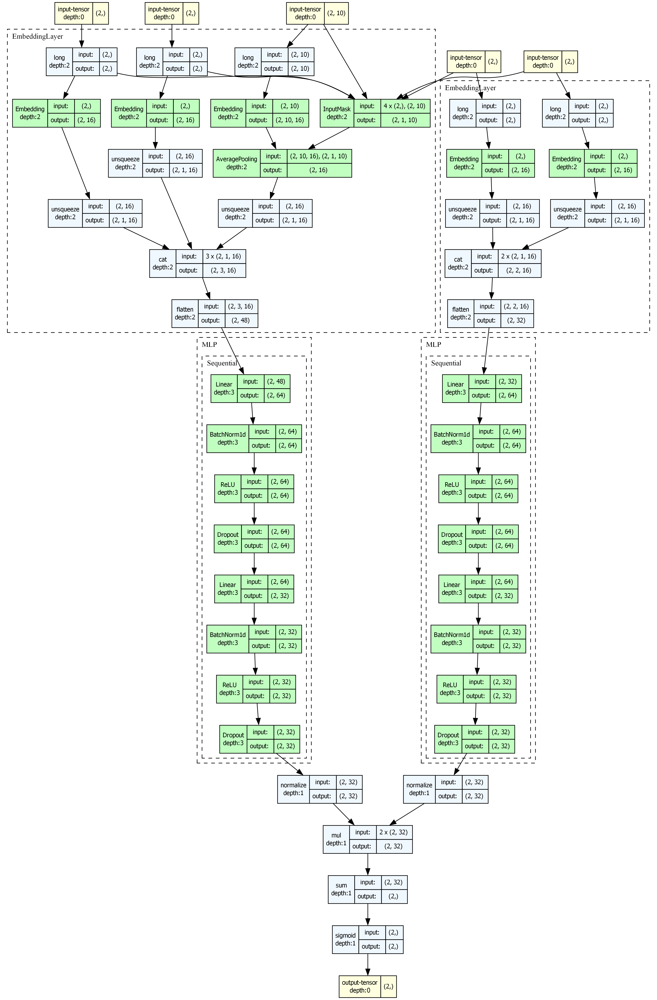

# DSSM Tutorial

## 1. Model Overview and Use Cases

DSSM encodes users and movies separately. The user tower reads profile attributes and viewing history, and the item tower reads movie IDs and genres. After training, you can compute the catalog's movie embeddings once and look up the closest movies for each user.

**Paper**: [Learning Deep Structured Semantic Models for Web Search using Clickthrough Data](https://posenhuang.github.io/papers/cikm2013_DSSM_fullversion.pdf)

### Model Architecture

<div align="center">
  
</div>

Each side of the diagram can run independently. Both towers produce 64-dimensional vectors in this example. Their cosine similarity determines the match score.

---

## 2. Data Preparation and Preprocessing

Each row of the bundled MovieLens-1M sample gives a user, a movie and the time the user rated it. The example treats that interaction as a positive. It does not use the rating value as a regression target.

### 2.1 Load and Process Data

```python
import os
import numpy as np
import pandas as pd
import torch
from sklearn.preprocessing import LabelEncoder

from torch_rechub.basic.features import SparseFeature, SequenceFeature
from torch_rechub.utils.data import MatchDataGenerator, df_to_dict
from torch_rechub.utils.match import gen_model_input, generate_seq_feature_match

# Load sampled MovieLens data
data = pd.read_csv("examples/matching/data/ml-1m/ml-1m_sample.csv")
data["cate_id"] = data["genres"].apply(lambda x: x.split("|")[0])

# Define discrete features
sparse_features = ['user_id', 'movie_id', 'gender', 'age', 'occupation', 'zip', 'cate_id']
user_col, item_col = "user_id", "movie_id"
```

### 2.2 Encode Features

```python
raw_id_maps = {}
feature_max_idx = {}
for feature in sparse_features:
    lbe = LabelEncoder()
    data[feature] = lbe.fit_transform(data[feature]) + 1
    feature_max_idx[feature] = data[feature].max() + 1

    # Map the encoded user and movie IDs back to their original values for evaluation.
    if feature in (user_col, item_col):
        raw_id_maps[feature] = dict(enumerate(lbe.classes_, start=1))

os.makedirs("saved/dssm", exist_ok=True)
np.save("saved/dssm/raw_id_maps.npy", [raw_id_maps[user_col], raw_id_maps[item_col]])

# Extract user/item profiles
user_profile = data[["user_id", "gender", "age", "occupation", "zip"]].drop_duplicates("user_id")
item_profile = data[["movie_id", "cate_id"]].drop_duplicates("movie_id")
```

### 2.3 Build Sequence Features and Training Data

```python
# Generate sequence features (user behavior histories) and negative samples
df_train, df_test = generate_seq_feature_match(
    data, user_col, item_col,
    time_col="timestamp",
    item_attribute_cols=[],
    sample_method=1,    # Sample in proportion to item popularity raised to the power of 0.75.
    mode=0,             # point-wise
    neg_ratio=3,        # Negative-sample ratio
    min_item=0
)

# Build model inputs
x_train = gen_model_input(df_train, user_profile, user_col, item_profile, item_col, seq_max_len=50)
y_train = x_train["label"]
x_train = {k: v for k, v in x_train.items() if k != "label"}
x_test = gen_model_input(df_test, user_profile, user_col, item_profile, item_col, seq_max_len=50)
```

### 2.4 Define Features

```python
user_cols = ['user_id', 'gender', 'age', 'occupation', 'zip']
item_cols = ['movie_id', 'cate_id']

# User features = user attributes + historical behavior sequence
# DSSM does not model complex temporal relations directly; it first compresses the history into a fixed user vector
user_features = [
    SparseFeature(name, vocab_size=feature_max_idx[name], embed_dim=16)
    for name in user_cols
]
user_features += [
    SequenceFeature(
        "hist_movie_id",
        vocab_size=feature_max_idx["movie_id"],
        embed_dim=16,
        pooling="mean",           # Sequence aggregation method
        shared_with="movie_id", padding_idx=0,
    )
]

# Item features
item_features = [
    SparseFeature(name, vocab_size=feature_max_idx[name], embed_dim=16, padding_idx=0)
    for name in item_cols
]

# Full item data used for evaluation
all_item = df_to_dict(item_profile)
test_user = x_test
```

### 2.5 Create DataLoaders

```python
dg = MatchDataGenerator(x=x_train, y=y_train)
train_dl, test_dl, item_dl = dg.generate_dataloader(
    test_user, all_item, batch_size=4096, num_workers=0
)
```

---

## 3. Model Configuration and Parameter Reference

### 3.1 Create the Model

```python
from torch_rechub.models.matching import DSSM

model = DSSM(
    user_features=user_features,
    item_features=item_features,
    temperature=1.0,  # Used by full-batch in-batch training, not point-wise BCE
    user_params={
        "dims": [256, 128, 64],
        "activation": "prelu"      # Use PReLU in the hidden layers.
    },
    item_params={
        "dims": [256, 128, 64],
        "activation": "prelu"
    }
)
```

### 3.2 Parameter Details

| Parameter | Type | Description | Suggested Value |
|------|------|------|--------|
| `user_features` | `list[Feature]` | User-side feature list | User attributes + behavior sequence |
| `item_features` | `list[Feature]` | Item-side feature list | Item ID + attributes |
| `temperature` | `float` | Finite positive temperature for in-batch cross-entropy | Default: 1.0 |
| `user_params.dims` | `list[int]` | User Tower MLP dimensions | `[256, 128, 64]` |
| `item_params.dims` | `list[int]` | Item Tower MLP dimensions | `[256, 128, 64]` |
| `*_params.activation` | `str` | Activation function | `"prelu"` in this example |

In the default training setup, DSSM computes the cosine similarity between the user and movie vectors, then applies a sigmoid. The in-batch example in section 4.3 also uses `temperature`.

---

## 4. Training Process and Code Example

### 4.1 Train the Model

```python
import os
from torch_rechub.trainers import MatchTrainer

torch.manual_seed(2022)
save_dir = "./saved/dssm/"
os.makedirs(save_dir, exist_ok=True)

trainer = MatchTrainer(
    model,
    mode=0,                        # 0: point-wise, 1: pair-wise, 2: list-wise
    optimizer_params={
        "lr": 1e-4,
        "weight_decay": 1e-6
    },
    n_epoch=10,
    device="cpu",
    model_path=save_dir
)

trainer.fit(train_dl)
```

### 4.2 Training Mode Reference

| mode | Training Method | Loss Function | Description |
|------|---------|---------|------|
| 0 | Point-wise | BCE Loss | Computes each sample independently |
| 1 | Pair-wise | BPR Loss | Requires the model to return `(pos_score, neg_score)`, as `FaceBookDSSM` does |
| 2 | List-wise | Softmax Loss | Requires the model to return `[B, 1+n_neg]` logits, as `YoutubeDNN` / `MIND` do |

This DSSM returns one score per user–movie pair, so we use `mode=0`. The other modes in the table expect different output shapes.

### 4.3 Single-Device In-Batch Training

Run from `examples/matching`:

```bash
python run_ml_dssm.py --in_batch_neg --batch_size 256 --temperature 0.02 --device cpu
```

To run on a single NVIDIA GPU, replace `--device cpu` with `--device cuda:0`. The script builds the training data for the selected sampling mode. Omit `--in_batch_neg` to train with positive and negative examples and the default BCE loss.

For in-batch training, put one observed user–movie interaction in each row. With `B` rows, both towers produce `B` vectors. The trainer computes `user_emb @ item_emb.T / model.temperature` and learns to rank the movie on each row's diagonal above the others. The same positional rule applies if a movie occurs twice in a batch. At least two rows are required. The trainer skips a final batch of one.

The [retrieval tutorial](/tutorials/retrieval) shows the full Python example. Use the same flag when building the training set and configuring the trainer, and load that run's weights when exporting embeddings. Evaluate the retrieved movies against held-out interactions. To measure AUC as well, prepare a separate validation set with both 0 and 1 labels.

---

## 5. Model Evaluation and Result Analysis

### 5.1 Generate Embeddings and Evaluate

To evaluate DSSM, first generate the user and item embeddings, then use vector retrieval to compute Recall@K.

```python
# Generate user embeddings
user_embedding = trainer.inference_embedding(
    model=model, mode="user",
    data_loader=test_dl,
    model_path=save_dir
)

# Generate item embeddings
item_embedding = trainer.inference_embedding(
    model=model, mode="item",
    data_loader=item_dl,
    model_path=save_dir
)

print(f"User Embedding shape: {user_embedding.shape}")
print(f"Item Embedding shape: {item_embedding.shape}")
```

### 5.2 Recall@K Evaluation

```python
# Requires the match_evaluation helper
# Located in examples/matching/movielens_utils.py
from examples.matching.movielens_utils import match_evaluation

match_evaluation(
    user_embedding,
    item_embedding,
    test_user,
    all_item,
    raw_id_maps="saved/dssm/raw_id_maps.npy",
    topk=10,
)
```

---

## 6. Tuning Suggestions

### 6.1 Key Tuning Points

You can change the hidden widths of the towers independently. Their final widths must match for the dot product. In the default point-wise setup, `neg_ratio=3` pairs three negatives with each positive. For full in-batch training, the actual batch size determines how many movie candidates each user sees.

### 6.2 Vector Retrieval and Deployment

After training, you can insert the embeddings into a vector index for ANN (approximate nearest-neighbor) search. The project retains both the legacy wrappers under `torch_rechub.utils.match` and the Builder/Indexer API under `torch_rechub.serving`.

#### Option 1: Annoy (Lightweight and Suitable for Rapid Prototyping)

```bash
pip install "torch-rechub[annoy]"
```

```python
from torch_rechub.utils.match import Annoy

# Build an Annoy index
annoy = Annoy(n_trees=10, metric='angular')
annoy.fit(item_embedding)

# Query the Top-10 similar items for one user
indices, distances = annoy.query(user_embedding[0], n=10)
print(f"Top-10 item indices: {indices}")
print(f"Corresponding distances: {distances}")
```

#### Option 2: Faiss (This Project's Optional Dependency Is the CPU Build)

```bash
pip install "torch-rechub[faiss]"
```

```python
from torch_rechub.utils.match import Faiss
import numpy as np

# Make sure the embeddings are float32 NumPy arrays
item_emb_np = item_embedding.cpu().numpy().astype(np.float32)
user_emb_np = user_embedding.cpu().numpy().astype(np.float32)

# Create a Faiss index (supports flat / ivf / hnsw)
faiss_index = Faiss(dim=item_emb_np.shape[1], index_type='flat', metric='l2')
faiss_index.fit(item_emb_np)

# Query the Top-10
indices, distances = faiss_index.query(user_emb_np[0], n=10)
print(f"Top-10 item indices: {indices}")
# With metric='l2', distances are distances, so smaller values mean nearer neighbors

# Save / load the index
faiss_index.save_index("item_faiss.index")
faiss_index.load_index("item_faiss.index")
```

> **Choosing a Faiss index type** (the practical scale limit depends on dimensionality, memory, and retrieval parameters, so benchmark your own workload):
> | Type | Characteristics | Suitable Scenario |
> |------|------|---------|
> | `flat` | Exact search; no training required | Small scale or a recall baseline |
> | `ivf` | Inverted-file index; requires training | Trading off speed against recall |
> | `hnsw` | Graph index; no training required | High-recall requirements |

For a persistent local index, see [Map index rows back to the original movie IDs](/serving/demo). Before using Milvus, read about [temporary collection lifetimes](/serving/vector_index). The legacy `torch_rechub.utils.match.Milvus` constructor deletes any existing collection named `rechub`.

## 7. Model Visualization

Torch-RecHub includes a `torchview`-based model-visualization utility that can generate a model's computation graph.

### Install Dependencies

```bash
pip install torch-rechub[visualization]
# Also install the system-level graphviz package:
# Ubuntu: sudo apt-get install graphviz
# macOS: brew install graphviz
# Windows: choco install graphviz
```

### Visualize the DSSM Model

```python
from torch_rechub.utils.visualization import visualize_model

# Generate inputs automatically and visualize the model (displayed directly in Jupyter)
graph = visualize_model(model, depth=4)

# Save as an image (suitable for papers/documentation)
visualize_model(model, save_path="dssm_architecture.png", dpi=300)

# Save as PDF
visualize_model(model, save_path="dssm_architecture.pdf")
```

> The visualizer extracts feature metadata from the model and generates dummy inputs automatically; you do not need to construct inputs manually.


### DSSM Architecture Diagram


---

## 8. ONNX Export

Install the optional ONNX dependencies before exporting the model:

```bash
pip install "torch-rechub[onnx]"
```

The exported files can be consumed by a compatible ONNX Runtime. A complete serving and deployment workflow is outside the scope of this project.

### Export the Full Model

```python
from torch_rechub.utils.onnx_export import ONNXExporter

exporter = ONNXExporter(model, device="cpu")

# Export the full DSSM model
exporter.export("dssm_full.onnx", verbose=True)
```

### Export the User Tower and Item Tower Separately

A two-tower model can export its towers independently for separate deployment:

```python
# Export the User Tower (real-time online inference)
exporter.export("dssm_user_tower.onnx", mode="user")

# Export the Item Tower (offline batch computation)
exporter.export("dssm_item_tower.onnx", mode="item")
```

### Run Inference with ONNX Runtime

```python
import onnxruntime as ort
import numpy as np

# Load the User Tower
session = ort.InferenceSession("dssm_user_tower.onnx")

# Inspect input metadata
for inp in session.get_inputs():
    print(f"  {inp.name}: shape={inp.shape}, type={inp.type}")

# Construct inputs and run inference
input_feed = {}
for inp in session.get_inputs():
    shape = [dim if isinstance(dim, int) else 1 for dim in inp.shape]
    dtype = np.int64 if "int" in inp.type.lower() else np.float32
    input_feed[inp.name] = np.zeros(shape, dtype=dtype)
output = session.run(None, input_feed)
print(f"User Embedding shape: {output[0].shape}")
```

---

## 9. FAQ and Troubleshooting

### Q1: Must the `dims` of the User Tower and Item Tower be identical?
Their final output dimensions (`dims[-1]`) must match because the model needs to compute similarity. Their intermediate dimensions may differ.

### Q2: How do I add user behavior sequence features?
Define the historical behavior sequence with `SequenceFeature` and share its embedding with the item ID through `shared_with`:

```python
SequenceFeature("hist_movie_id", vocab_size=n_movie,
                embed_dim=16, pooling="mean",
                shared_with="movie_id", padding_idx=0)
```

### Q3: How can DSSM be deployed efficiently online?
The key is to **decouple users and items**:
1. Compute all item embeddings offline and store them in a vector database (Faiss/Milvus)
2. Compute user embeddings in real time with ONNX Runtime
3. Retrieve the most similar Top-K items through ANN search

### Q4: Does `temperature` affect the current DSSM implementation?
With in-batch sampling, the trainer divides each similarity by `temperature` before computing cross-entropy. Changing the temperature has no effect in the default point-wise example.

### Q5: How should I choose among Annoy, Faiss, and Milvus?

| Characteristic | Annoy | Faiss | Milvus |
|------|-------|-------|--------|
|----------------|-------|--------|--------|
| Project optional dependency | `annoy` | `faiss-cpu` | `pymilvus` |
| Persistence | Can save indexes | Can save indexes | The current Serving context deletes its temporary collection on exit |
| Current recommendation | Rapid prototyping | Single-node experiments and benchmarking | Validate only in an isolated instance; do not use directly for persistent production data |

---

## Run the example script

Run this from the repository root. The script saves the ID maps and weights, then evaluates the recommendations.

```bash
cd examples/matching
uv run --extra annoy python run_ml_dssm.py --epoch 1 --device cpu
```
