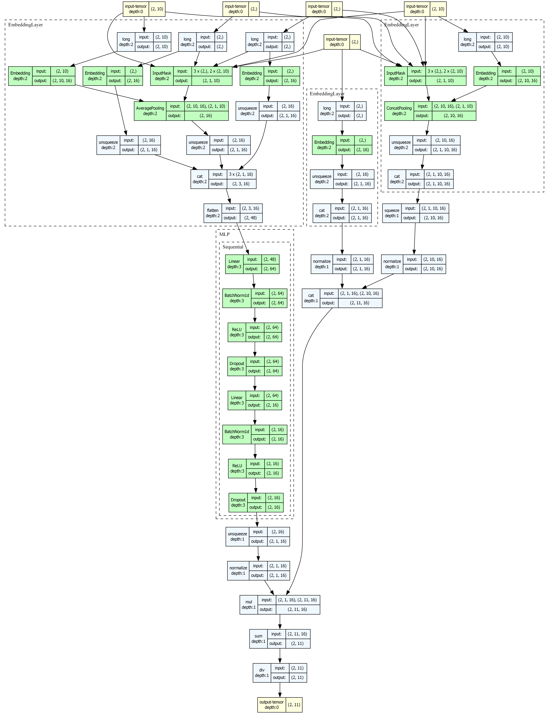

# YoutubeDNN Tutorial

## 1. Model Overview and Use Cases

YoutubeDNN uses a user's attributes and viewing history to compute a user vector. Each movie vector comes directly from the movie ID embedding table. During training, the model picks the observed movie from a list of candidates. At recommendation time, the same user vector can search the whole catalog.

**Paper**: [Deep Neural Networks for YouTube Recommendations](https://dl.acm.org/doi/10.1145/2959100.2959190)

### Model Architecture

<div align="center">
  
</div>

The user network on the left produces one vector. On the right, positive and negative movies share one embedding table. Both sides must use the same output width to compute similarity.

---

## 2. Data Preparation and Preprocessing

This MovieLens example uses `mode=2`. With `neg_ratio=3`, each row has four candidates: the observed movie first, followed by three sampled negatives. The target is the candidate position `0`.

```python
import os
import numpy as np
import pandas as pd
import torch
from sklearn.preprocessing import LabelEncoder

from torch_rechub.basic.features import SparseFeature, SequenceFeature
from torch_rechub.utils.data import MatchDataGenerator, df_to_dict
from torch_rechub.utils.match import gen_model_input, generate_seq_feature_match

data = pd.read_csv("examples/matching/data/ml-1m/ml-1m_sample.csv")
data["cate_id"] = data["genres"].apply(lambda x: x.split("|")[0])

sparse_features = ['user_id', 'movie_id', 'gender', 'age', 'occupation', 'zip', 'cate_id']
user_col, item_col = "user_id", "movie_id"

feature_max_idx = {}
for feature in sparse_features:
    lbe = LabelEncoder()
    data[feature] = lbe.fit_transform(data[feature]) + 1
    feature_max_idx[feature] = data[feature].max() + 1

user_profile = data[["user_id", "gender", "age", "occupation", "zip"]].drop_duplicates("user_id")
item_profile = data[["movie_id", "cate_id"]].drop_duplicates("movie_id")

# mode=2: list-wise negative sampling; negative items are stored in the "neg_items" column
df_train, df_test = generate_seq_feature_match(
    data, user_col, item_col,
    time_col="timestamp",
    item_attribute_cols=[],
    sample_method=1,
    mode=2,           # list-wise mode
    neg_ratio=3,
    min_item=0
)

x_train = gen_model_input(df_train, user_profile, user_col, item_profile, item_col, seq_max_len=50)
# In list-wise training, label 0 means that the first position contains the positive item
y_train = np.array([0] * df_train.shape[0])
x_test = gen_model_input(df_test, user_profile, user_col, item_profile, item_col, seq_max_len=50)
```

### Define Features

```python
user_cols = ['user_id', 'gender', 'age', 'occupation', 'zip']

# User features = user attributes + historical behavior sequence
user_features = [
    SparseFeature(name, vocab_size=feature_max_idx[name], embed_dim=16)
    for name in user_cols
]
user_features += [
    SequenceFeature("hist_movie_id", vocab_size=feature_max_idx["movie_id"],
                    embed_dim=16, pooling="mean", shared_with="movie_id", padding_idx=0)
]

# Item features (movie_id embedding only)
item_features = [
    SparseFeature("movie_id", vocab_size=feature_max_idx["movie_id"], embed_dim=16, padding_idx=0)
]

# Negative-item feature
neg_item_feature = [
    SequenceFeature("neg_items", vocab_size=feature_max_idx["movie_id"],
                    embed_dim=16, pooling="concat", shared_with="movie_id")
]

all_item = df_to_dict(item_profile)
test_user = x_test

# Create DataLoaders
dg = MatchDataGenerator(x=x_train, y=y_train)
train_dl, test_dl, item_dl = dg.generate_dataloader(test_user, all_item, batch_size=2048, num_workers=0)
```

---

## 3. Model Configuration and Parameter Reference

### 3.1 Create the Model

```python
from torch_rechub.models.matching import YoutubeDNN

model = YoutubeDNN(
    user_features=user_features,
    item_features=item_features,
    neg_item_feature=neg_item_feature,
    user_params={"dims": [128, 64, 16]},
    temperature=0.02
)
```

### 3.2 Parameter Details

| Parameter | Type | Description | Recommended Value |
|------|------|------|--------|
| `user_features` | `list[Feature]` | User-side features | User attributes + sequence |
| `item_features` | `list[Feature]` | Positive-item features | Item ID |
| `neg_item_feature` | `list[Feature]` | Negative-item features | `SequenceFeature` + `pooling="concat"` |
| `user_params.dims` | `list[int]` | User Tower MLP dimensions | `[128, 64, 16]` |
| `temperature` | `float` | Temperature coefficient | 0.02–0.1 |

> **Note**: The `shared_with` value of `neg_item_feature` must match the item ID feature name in `item_features`, ensuring that positive and negative items share the same embedding.

---

## 4. Training Process and Code Example

```python
import os
from torch_rechub.trainers import MatchTrainer

torch.manual_seed(2022)
save_dir = "./saved/youtube_dnn/"
os.makedirs(save_dir, exist_ok=True)

trainer = MatchTrainer(
    model,
    mode=2,                     # list-wise training; YoutubeDNN normally does not use point-wise mode
    optimizer_params={
        "lr": 1e-4,
        "weight_decay": 1e-6
    },
    n_epoch=10,
    device="cpu",
    model_path=save_dir
)

trainer.fit(train_dl)
```

### DSSM vs. YoutubeDNN Training Modes

| Item | DSSM (`mode=0`) | YoutubeDNN (`mode=2`) |
|--------|--------------|---------------------|
| Training objective | Point-wise (BCE) | List-wise (Softmax) |
| Negative sampling | Independent negative samples | A list containing one positive and multiple negative items |
| Labels | 0/1 | Always 0 (the first item in the list is positive) |

---

## 5. Model Evaluation and Result Analysis

```python
# Generate embeddings
user_embedding = trainer.inference_embedding(
    model=model, mode="user",
    data_loader=test_dl,
    model_path=save_dir
)
item_embedding = trainer.inference_embedding(
    model=model, mode="item",
    data_loader=item_dl,
    model_path=save_dir
)

print(f"User Embedding: {user_embedding.shape}")
print(f"Item Embedding: {item_embedding.shape}")
```

---

## 6. Tuning Recommendations

The user network's output width and the movie `embed_dim` are both 16 here. Increasing `neg_ratio` adds more candidate movies and more similarity calculations per training example. `seq_max_len` sets how many past interactions the user tower can see.

### 6.1 Vector Retrieval and Deployment

As with DSSM, after training YoutubeDNN you need to insert its embeddings into a vector index for ANN retrieval.

```python
from torch_rechub.utils.match import Annoy, Faiss

# Option 1: Annoy (fast prototyping)
annoy = Annoy(n_trees=10)
annoy.fit(item_embedding)
indices, distances = annoy.query(user_embedding[0], n=10)

# Option 2: Faiss (high performance)
import numpy as np
item_emb_np = item_embedding.cpu().numpy().astype(np.float32)
faiss_index = Faiss(dim=item_emb_np.shape[1], index_type='flat', metric='l2')
faiss_index.fit(item_emb_np)
indices, distances = faiss_index.query(user_embedding[0].cpu().numpy().astype(np.float32), n=10)

# Save the index for online serving
faiss_index.save_index("youtube_dnn_item.index")
```

> For **more vector-retrieval details**, see section “6.2 Vector Retrieval and Deployment” in the [DSSM tutorial](/tutorials/models/matching/dssm), which explains each backend's dependencies and implementation boundaries.

---

## 7. Model Visualization

```python
from torch_rechub.utils.visualization import visualize_model

# Automatically generate inputs and visualize the model
graph = visualize_model(model, depth=4)

# Save the image
visualize_model(model, save_path="youtube_dnn_arch.png", dpi=300)
```

### YoutubeDNN Architecture


> Install the dependencies with `pip install torch-rechub[visualization]`, and install Graphviz on the system (Ubuntu: `apt-get install graphviz` / macOS: `brew install graphviz` / Windows: `choco install graphviz`).

---

## 8. ONNX Export

First install the optional ONNX dependencies:

```bash
pip install "torch-rechub[onnx]"
```

```python
from torch_rechub.utils.onnx_export import ONNXExporter

exporter = ONNXExporter(model, device="cpu")

# Export the User and Item Towers separately
exporter.export("youtube_user_tower.onnx", mode="user")
exporter.export("youtube_item_tower.onnx", mode="item")
```

---

## 9. FAQ and Troubleshooting

### Q1: What are the main differences between YoutubeDNN and DSSM?
This YoutubeDNN example computes cross-entropy over a candidate list. The DSSM tutorial scores individual user–movie pairs by default and also supports in-batch sampling. The item towers differ as well: YoutubeDNN looks up the movie ID embedding directly, while DSSM feeds several movie fields through an item tower.

### Q2: Why does `y_train` contain only zeros?
In list-wise (`mode=2`) training, label `0` means that the item in the **first position** of the list is positive. The model must learn to rank that positive item above the negatives.

### Q3: Why does `neg_item_feature` use `pooling="concat"`?
The negative samples form a list of multiple items. `pooling="concat"` preserves them in a `[batch_size, n_neg, embed_dim]` tensor for the list-wise computation.

### Q4: How can I export ONNX models for online deployment?
Use `ONNXExporter` to export the User and Item Towers separately. Run the User Tower with ONNX Runtime online, then retrieve items from a vector index such as Faiss or Milvus.

---

## Run the example script

Run this from the repository root. The script saves the ID maps and weights, then evaluates the recommendations.

```bash
cd examples/matching
uv run --extra annoy python run_ml_youtube_dnn.py --epoch 1 --device cpu
```
