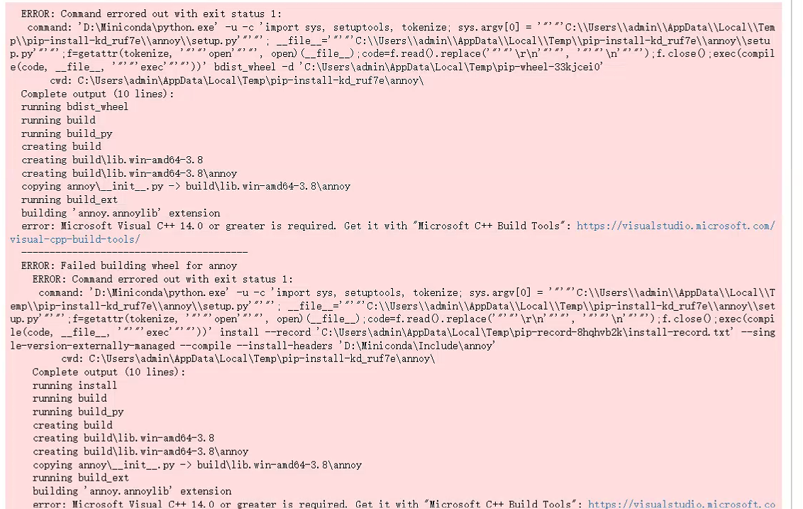

# 常见问题解答

## 会推出 TensorFlow 版本吗？

项目目前使用 PyTorch，暂无 TensorFlow 版本计划。

## 为什么示例的 AUC 很低或波动很大？

仓库自带的数据只取了很小一部分，换几条验证记录就可能让 AUC 明显变化。第一次跑示例，先确认训练结束、预测有输出。要比较两个模型，再换用完整数据集，并让两个模型共用同一份训练、验证和测试划分。[排序数据说明](https://github.com/datawhalechina/torch-rechub/tree/main/examples/ranking) · [召回数据说明](https://github.com/datawhalechina/torch-rechub/tree/main/examples/matching)

## Annoy 在 Windows 上安装失败怎么办？

先用当前 Python 环境安装 Annoy 依赖。

```bash
python -m pip install "torch-rechub[annoy]"
```

如果没有适合当前 Python 版本的预编译包，pip 会从源码编译 Annoy。出现 `Microsoft Visual C++ 14.0 or greater is required` 时，安装 Microsoft C++ Build Tools，重新打开终端后再运行上面的命令。[Microsoft C++ Build Tools](https://visualstudio.microsoft.com/visual-cpp-build-tools/)



## 只使用 Annoy 需要安装哪些依赖？

运行上面的安装命令就够了。`builder_factory("annoy", d=64)` 使用本地 Annoy 索引，只有选用 Milvus 才需要连接服务端。

## 为什么 `fit()` 时提示模型保存路径不存在？

用 `CTRTrainer`、`MatchTrainer` 或 `MTLTrainer` 时，先创建 `model_path` 指向的目录。下面把排序模型保存在 `saved/deepfm`。

```python
import os
from torch_rechub.trainers import CTRTrainer

os.makedirs("saved/deepfm", exist_ok=True)
trainer = CTRTrainer(model, model_path="saved/deepfm")
trainer.fit(train_dataloader, val_dataloader)
```

## 为什么从不同目录运行示例会提示数据文件不存在？

有些脚本把数据写成 `./data/...`。Python 会从启动命令时的工作目录找这个文件。比如运行排序示例前，先进入 `examples/ranking`。如果脚本提供 `--dataset_path`，也可以直接传数据的绝对路径。

## 同一批 Feature 可以同时传给多个模型吗？

独立训练两个模型时，两个模型可以读同名的 `item_id` 列，各自新建 `SparseFeature` 或 `SequenceFeature` 即可。如果直接把同一个 Feature 对象传两次，两个模型会拿到同一张已经创建的嵌入表。在一个模型里希望历史物品和目标物品共用这张表时，用 `shared_with` 指定对应的物品特征。[特征与嵌入表](/zh/core/features#feature-实例与-embedding-所有权)

