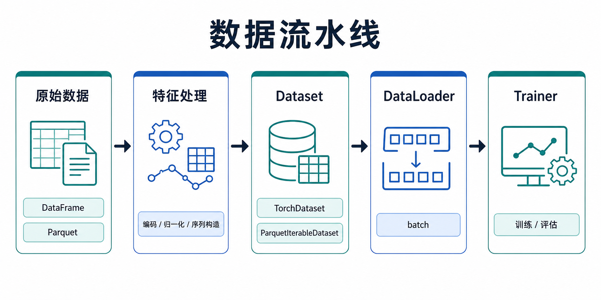

# 数据流水线

在排序任务里，一条训练样本包含一组特征和一个标签。先把城市、电影等类别换成整数，把同一批用户的历史补到相同长度，再让 DataLoader 把这些样本分批交给训练器。[特征定义](/zh/core/features)



## 数据类

### TorchDataset

`dataset[i]` 取出第 `i` 行的特征和对应标签。`x` 用特征名作键，`y[i]` 要和各列的第 `i` 个值属于同一条记录。

```python
from torch_rechub.utils.data import TorchDataset

# x 可以是特征名到数组/Tensor 的映射，也可以是 DataFrame
dataset = TorchDataset(x, y)
```

传入 DataFrame 时，确保各列可以用从 `0` 开始的行号取值。切分后保留了原行索引的数据，可先调用 `reset_index(drop=True)` 或将各列转成数组。

### PredictDataset

算用户或物品向量时，手上往往只有特征。`PredictDataset` 每次返回一行特征字典。

```python
from torch_rechub.utils.data import PredictDataset

# 创建预测数据集
dataset = PredictDataset(x)
```

## 数据生成器

### DataGenerator

`DataGenerator` 可以把已有的特征和标签随机切为三份。下面两项比例分别留给训练集和验证集，余下的进测试集。

```python
from torch_rechub.utils.data import DataGenerator

# 创建数据生成器
dg = DataGenerator(x, y)
# 生成数据加载器
train_dl, val_dl, test_dl = dg.generate_dataloader(
    split_ratio=[0.7, 0.1],  # 70% 训练、10% 验证，剩余 20% 测试
    batch_size=256,           # 批次大小
    num_workers=8             # 读取数据的子进程数
)
```

如果已经按时间或业务规则切好了数据，用训练集创建 `dg`，把验证集和测试集分别传给下面四个参数。

```python
train_dl, val_dl, test_dl = dg.generate_dataloader(
    x_val=x_val,
    y_val=y_val,
    x_test=x_test,
    y_test=y_test,
    batch_size=256,
)
```

> `split_ratio` 路径底层使用 `torch.utils.data.random_split`。如需可复现切分，请在生成 DataLoader 之前设置 `torch.manual_seed(...)`。

### MatchDataGenerator

双塔召回要读三份数据。`train_dl` 提供训练样本，`test_dl` 按测试用户顺序提供用户侧特征，`item_dl` 按电影目录顺序提供物品侧特征。后两份保留输入顺序，后续可以把每一行向量对应回用户或电影。

```python
from torch_rechub.utils.data import MatchDataGenerator

# 创建召回数据生成器
dg = MatchDataGenerator(x, y)
# 生成数据加载器
train_dl, test_dl, item_dl = dg.generate_dataloader(
    x_test_user=x_test_user,  # 测试用户数据
    x_all_item=x_all_item,    # 所有物品数据
    batch_size=256,           # 批次大小
    num_workers=8             # 读取数据的子进程数
)
```

## 工具函数

### get_auto_embedding_dim

根据类别数量自动计算嵌入向量长度。

```python
from torch_rechub.utils.data import get_auto_embedding_dim

# 自动计算嵌入向量长度
embed_dim = get_auto_embedding_dim(num_classes=1000)
```

**参数说明：**
- `num_classes`：类别数量

**返回值：**
- 嵌入向量长度，计算公式：`int(np.floor(6 * np.pow(num_classes, 0.25)))`

### get_loss_func

根据任务类型获取对应的损失函数。

```python
from torch_rechub.utils.data import get_loss_func

# 获取分类任务损失函数
loss_func = get_loss_func(task_type="classification")
# 获取回归任务损失函数
loss_func = get_loss_func(task_type="regression")
```

**参数说明：**
- `task_type`：任务类型，可选值：classification（分类）、regression（回归）

**返回值：**
- `classification` 返回 `torch.nn.BCELoss`（输入应是 `[0, 1]` 内的概率，不是未经 sigmoid 的 logits）
- `regression` 返回 `torch.nn.MSELoss`

## 序列数据

`SequenceDataGenerator` 面向 HSTU/HLLM 这类 next-item 任务。它接收四个第一维长度一致的 NumPy 数组，每个 batch 返回 `(seq_tokens, seq_positions, seq_time_diffs, targets)`。

```python
from torch_rechub.utils.data import SequenceDataGenerator

generator = SequenceDataGenerator(
    seq_tokens,
    seq_positions,
    targets,
    seq_time_diffs,
)

# 数据已经分好时，返回值是长度为 1 的 tuple
train_dl = generator.generate_dataloader(
    batch_size=32,
    num_workers=0,
)[0]

# 自动切分时必须传入三个且总和为 1 的比例
train_dl, val_dl, test_dl = generator.generate_dataloader(
    batch_size=32,
    split_ratio=(0.7, 0.1, 0.2),
)
```

## Parquet 流式数据加载

如果训练数据已经按文件存成 Parquet，可以直接逐批读。比如 Spark 写出了多个 `part-*.parquet`，把这些文件路径交给 `ParquetIterableDataset` 即可，省去用 `toPandas()` 把整张表收回一台机器的步骤。

### 安装依赖

Parquet 数据加载需要 `bigdata` extra：

```bash
python -m pip install "torch-rechub[bigdata]"
```

### ParquetIterableDataset

下面每次读出最多 1024 行。数据集返回的字典已经是一批数据，因此外层 `DataLoader` 用 `batch_size=None`。`split_label` 把字典里的 `label` 单独取出来，组成排序训练器接收的 `(特征字典, 标签)`。

```python
from torch.utils.data import DataLoader
from torch_rechub.data.dataset import ParquetIterableDataset

# 创建流式数据集
dataset = ParquetIterableDataset(
    ["/data/train1.parquet", "/data/train2.parquet"],
    columns=["user_id", "item_id", "label"],  # 可选，指定读取的列
    batch_size=1024,  # 每批次读取的行数
)

# 每次读取的字典已经是一个 batch。collate_fn 把标签与模型输入分开。
def split_label(batch):
    x = {name: value for name, value in batch.items() if name != "label"}
    return x, batch["label"]

loader = DataLoader(dataset, batch_size=None, collate_fn=split_label)
```

把 `loader` 传给 `CTRTrainer.fit` 就可以开始训练。要在每轮结束时算 AUC，可用 `DataGenerator` 准备一个有长度的 `val_dl`，再调用 `trainer.fit(loader, val_dl)`。两边的特征名和标签含义要一致。Windows 下使用多个 worker 时，把 `split_label` 放在模块顶层，便于子进程导入。

**参数说明：**
- `file_paths`：Parquet 文件路径列表
- `columns`：要读取的列名列表，`None` 表示读取所有列
- `batch_size`：每批次读取的行数，默认 1024

多个 worker 会分头读取不同的文件。如果只传一个文件，增加 worker 也不会把这个文件再拆开。

### 与 Spark 配合使用

```python
# ========== Spark 端 ==========
# df.write.parquet("/data/train.parquet")

# ========== PyTorch 端 ==========
import glob
from torch.utils.data import DataLoader
from torch_rechub.data.dataset import ParquetIterableDataset

file_paths = glob.glob("/data/train.parquet/*.parquet")
dataset = ParquetIterableDataset(file_paths, batch_size=2048)
loader = DataLoader(dataset, batch_size=None, num_workers=8)
```

### 支持的数据类型

| Parquet/Arrow 类型 | 转换结果 |
|-------------------|---------|
| int8/16/32/64 | torch.float32 |
| float32/64 | torch.float32 |
| boolean | torch.float32 |
| list/array | torch.Tensor (2D) |

> **注意**：嵌套数组（如 Spark 的 `Array<Float>`）要求每行长度相同，否则会抛出 `ValueError`。

> **类型限制**：当前转换器不支持 Arrow 字符串列。请在生成 Parquet 前将类别字符串编码为数值 ID。所有受支持的标量列（包括整数 ID）都会转为 `torch.float32`；传入 Embedding 层时模型会再转为整数索引。`float32` 无法精确表示大于 `2^24` 的所有整数，因此请先将超大业务 ID 重映射到紧凑的连续索引。

排序数据的完整例子可以看[准备 Criteo 输入](/zh/guide/quick_start#criteo-input)。如果要从交互记录构造用户历史和召回样本，可以接着看[MovieLens 召回教程](/zh/tutorials/retrieval)。
