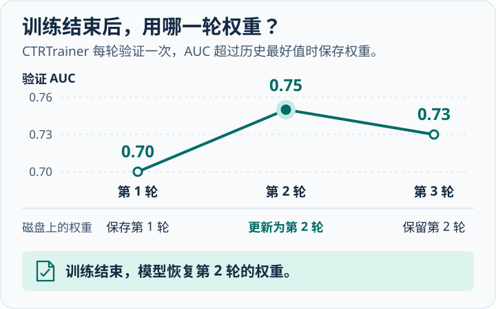

# 训练与评估

DeepFM 为每条候选记录预测点击概率，用 `CTRTrainer`。DSSM 需要分别导出用户和物品向量，用 `MatchTrainer`。一条记录有多个预测目标时用 `MTLTrainer`。HSTU 和 HLLM 根据历史预测下一件物品，用 `SeqTrainer`。



## 训练器

使用 `CTRTrainer`、`MatchTrainer` 或 `MTLTrainer` 前，先创建存放权重的目录 `model_path`。以排序为例，`fit(train_dl, val_dl)` 每轮比较验证 AUC，只要超过之前的最好成绩，就把权重写入 `model.pth`。即使下一轮中途退出，已经写入的权重也能加载。训练正常结束时，`trainer.model` 会恢复到验证 AUC 最好的那一轮。只传 `train_dl` 时，训练结束后保存最后一轮。

想看每个 batch 的损失和学习率，调用 `fit(train_dl, val_dl, log_interval=1)`。排序、召回和多任务训练器都接受这个参数。单卡训练用 `device="cuda:0"`，在同一台机器上用第 0、1 两张 CUDA 卡，可传 `device="cuda:0", gpus=[0, 1]`。

### CTRTrainer

先运行[准备 Criteo 输入](/zh/guide/quick_start#criteo-input)那一节，保留特征和三个 DataLoader。下面用 `train_dl` 更新参数，用 `val_dl` 选权重，最后才用 `test_dl` 算 AUC。

```python
import os

from torch_rechub.trainers import CTRTrainer
from torch_rechub.models.ranking import DeepFM

# 创建模型
model = DeepFM(deep_features=dense_feas + sparse_feas, fm_features=sparse_feas, mlp_params={"dims": [256, 128], "dropout": 0.2})

# 创建训练器
trainer = CTRTrainer(
    model=model,
    optimizer_params={"lr": 0.001, "weight_decay": 0.0001},
    n_epoch=50,
    earlystop_patience=10,
    device="cpu",
    model_path="saved/deepfm"
)

# 训练模型
os.makedirs("saved/deepfm", exist_ok=True)
trainer.fit(train_dl, val_dl)

# 评估模型
auc = trainer.evaluate(trainer.model, test_dl)

# 导出ONNX模型
example_batch, _ = next(iter(test_dl))
trainer.export_onnx("deepfm.onnx", dummy_input=example_batch)

# 可视化模型
trainer.visualization(save_path="deepfm_architecture.pdf")
```

`n_epoch` 是最多训练多少轮。`earlystop_patience` 决定验证指标连续多少轮没有改善就停止训练。上例最多训练 50 轮，容许连续 10 轮没有提升。`optimizer_params` 传给优化器，默认使用 `torch.optim.Adam`。如果模型的 `forward` 同时返回预测和额外损失，还要把 `loss_mode` 设为 `False`。

### MatchTrainer

下面用 DSSM 训练双塔。预测时，物品向量可以提前算好，用户向量按需要更新，所以两个塔可以各导出一个 ONNX 文件。

```python
import os

from torch_rechub.trainers import MatchTrainer
from torch_rechub.models.matching import DSSM

# 创建模型
model = DSSM(user_features=user_features, item_features=item_features, temperature=1.0,  # 用于批内采样的相似度缩放
             user_params={"dims": [256, 128, 64]}, item_params={"dims": [256, 128, 64]})

# 创建训练器
trainer = MatchTrainer(
    model=model,
    mode=0,  # 0: point-wise, 1: pair-wise, 2: list-wise
    optimizer_params={"lr": 0.001},
    n_epoch=50,
    device="cuda:0",
    model_path="saved/dssm"
)

# 训练模型
os.makedirs("saved/dssm", exist_ok=True)
trainer.fit(train_dataloader)

# 导出用户塔ONNX模型
trainer.export_onnx("user_tower.onnx", mode="user")

# 导出物品塔ONNX模型
trainer.export_onnx("item_tower.onnx", mode="item")
```

`mode=0` 按单个用户与物品的配对学习 0/1 标签。`mode=1` 比较一正一负两个物品，`mode=2` 从一组候选里挑出正例。数据要按所选模式构造。

如果用 DSSM 做批内采样，训练集只保留正交互，训练器开启 `in_batch_neg=True`。默认用同批其他行的物品作负例。可以通过 `in_batch_neg_ratio` 限制每个正例配几个负例，或用 `hard_negative=True` 优先选模型打分高的负例。[完整召回示例](/zh/tutorials/retrieval)

### MTLTrainer

下面的 MMOE 有两个分类任务。`task_types` 的顺序要和标签列、模型输出的顺序一致，训练器才能给每一列计算相应的损失。

```python
import os

from torch_rechub.trainers import MTLTrainer
from torch_rechub.models.multi_task import MMOE

# 创建模型
model = MMOE(features=features, task_types=["classification", "classification"], n_expert=8,
             expert_params={"dims": [32,16]}, tower_params_list=[{"dims": [32, 16]}, {"dims": [32, 16]}])

# 创建训练器
trainer = MTLTrainer(
    model=model,
    task_types=["classification", "classification"],
    optimizer_params={"lr": 0.001},
    adaptive_params={"method": "uwl"},  # 自适应损失权重方法
    n_epoch=50,
    earlystop_taskid=0,  # 早停依赖的任务ID
    device="cuda:0",
    model_path="saved/mmoe"
)

# 训练模型
os.makedirs("saved/mmoe", exist_ok=True)
trainer.fit(train_dataloader, val_dataloader)

# 导出ONNX模型
trainer.export_onnx("mmoe.onnx")
```

`adaptive_params=None` 时，各任务的损失等权平均。上例指定 `{"method": "uwl"}`，让训练过程学习各任务的权重。

早停只看选定的任务。`earlystop_taskid=0` 表示看第一列。若任务是 `["classification", "regression"]`，想用第二项的 MSE 选权重，就设置 `earlystop_taskid=1, earlystop_mode="min"`，这样 MSE 降低才算改善。[多任务教程](/zh/tutorials/pipeline)

### SeqTrainer

HSTU 和 HLLM 每批接收 `(seq_tokens, seq_positions, seq_time_diffs, targets)`。这里 `evaluate(test_dataloader)` 返回两个值，分别是平均损失和预测的第一名正好是目标物品的比例。

```python
import os

from torch_rechub.trainers import SeqTrainer

os.makedirs("saved/hstu", exist_ok=True)
trainer = SeqTrainer(
    model=model,
    optimizer_params={"lr": 1e-3, "weight_decay": 1e-5},
    n_epoch=10,
    device="cpu",
    model_path="saved/hstu",
    loss_type="cross_entropy",  # 单设备还可用 "sampled_softmax" 控制训练候选数量
)

history = trainer.fit(train_dataloader, val_dataloader)
test_loss, top1_accuracy = trainer.evaluate(test_dataloader)
trainer.export_onnx("hstu.onnx", vocab_size=model.vocab_size)
```

`SeqTrainer` 不使用传入 batch 的 `seq_positions`；当前 HSTU/HLLM 由模型内部推导位置。`loss_type="cross_entropy"` 默认忽略 token `0`，因此数据处理需要保证 `0` 专用于 padding。

## 实验跟踪与可视化

需要保存训练曲线时安装 `tracking`。画模型结构图和导出 ONNX 分别用到 `visualization` 和 `onnx`，按需安装即可。

```bash
python -m pip install "torch-rechub[tracking]"
python -m pip install "torch-rechub[visualization]"
python -m pip install "torch-rechub[onnx]"
```

下面同时把每轮损失和验证指标写入 W&B 与本地 TensorBoard 日志。只用一种工具时，`model_logger` 直接传一个实例即可。默认训练进度会打印在终端。

```python
from torch_rechub.basic.tracking import WandbLogger, TensorBoardXLogger
from torch_rechub.trainers import CTRTrainer

wb = WandbLogger(project="rechub-demo", name="deepfm")
tb = TensorBoardXLogger(log_dir="./runs/deepfm")

trainer = CTRTrainer(model, model_logger=[wb, tb])
trainer.fit(train_dataloader, val_dataloader)
```

## 评估指标

指标入口位于 `torch_rechub.basic.metric`：

```python
from torch_rechub.basic.metric import (
    auc_score,
    coverage_score,
    diversity_score,
    gauc_score,
    log_loss,
    novelty_score,
    topk_metrics,
)

auc = auc_score(y_true, y_score)
gauc = gauc_score(y_true, y_score, user_ids)
ranking = topk_metrics(ground_truth, recommendations, topKs=[5, 10])
diversity = diversity_score(recommendations, item_embeddings, topKs=[10])
coverage = coverage_score(recommendations, all_item_ids, topKs=[10])
novelty = novelty_score(recommendations, item_popularity, topKs=[10])
```

- `auc_score` 和 `log_loss` 接收逐样本标签/分数并返回浮点数；AUC 越大越好，log loss 越小越好。
- `gauc_score` 按用户分组计算 AUC；跳过只有一类标签的用户。若没有兼具正负标签且权重大于零的用户，会抛出 `ValueError`，可通过 `weights={user_id: weight}` 自定义加权。
- `topk_metrics` 计算 NDCG、MRR、Recall、Hit 和 Precision。`ground_truth` 与 `recommendations` 都是 `{user_id: [item_id, ...]}`，推荐列表至少需要包含 `max(topKs)` 个物品。
- `diversity_score`、`coverage_score`、`novelty_score` 分别衡量列表内差异、目录覆盖和平均自信息，都是越大越好。

`topk_metrics` 和多样性、覆盖率、新颖度函数都返回可直接打印的结果。例如 `ranking["Recall"]` 的内容形如 `["Recall@10: 0.1234"]`，列表元素是字符串。`ndcg_score`、`hit_score`、`mrr_score`、`recall_score`、`precision_score` 也返回对应的字符串列表。

## 回调函数

### EarlyStopper

默认 `mode="max"` 监控 AUC，`mode="min"` 适用于 loss 或 MSE。普通训练直接使用 Trainer 的 `earlystop_patience` 即可。自定义训练循环和权重恢复示例见[回调函数](/zh/tools/callbacks)。

## 损失函数

### RegularizationLoss

要给嵌入表和全连接层设置不同的正则化系数，可以分别指定 `embedding_l1/l2` 和 `dense_l1/l2`。在排序、召回和多任务训练器里，这些系数可以直接传给 `regularization_params`。

```python
from torch_rechub.basic.loss_func import RegularizationLoss

# 创建正则化损失函数
reg_loss_fn = RegularizationLoss(
    embedding_l1=0.0,  # Embedding层L1正则化系数
    embedding_l2=0.0001,  # Embedding层L2正则化系数
    dense_l1=0.0,  # 密集层L1正则化系数
    dense_l2=0.0001  # 密集层L2正则化系数
)
```

### BPRLoss

BPR 用于成对比较。对同一个用户，`pos_score` 是正例的分数，`neg_score` 是负例的分数，训练目标是让正例排在负例前面。

```python
from torch_rechub.basic.loss_func import BPRLoss

# 创建BPR损失函数
bpr_loss = BPRLoss()

# 计算损失
loss = bpr_loss(pos_score, neg_score)
```
