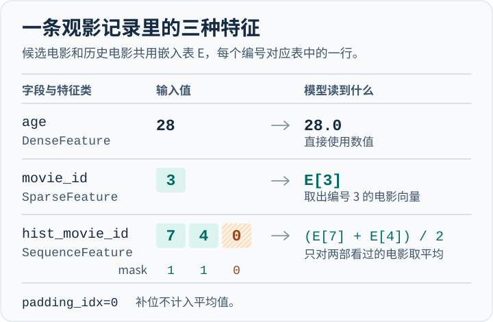

# 特征定义

先看一条样本里每一列装的是什么。年龄是一个数，城市是一个类别，观影历史是一串电影 ID。这三种输入分别用 `DenseFeature`、`SparseFeature` 和 `SequenceFeature` 描述。`name` 要和输入字典里的键一致。



## DenseFeature

下面的 `age` 每行只有一个数，所以 `embed_dim=1`。如果这一列本来就是一个 8 维数值向量，就填 `embed_dim=8`。

```python
from torch_rechub.basic.features import DenseFeature

# 创建数值型特征
dense_feature = DenseFeature(name="age", embed_dim=1)
```

## SparseFeature

先用词表把城市名换成整数，再用这个整数查一张嵌入表。下面的表有 100 行，接受的编号是 0 到 99，每次查出一个 16 维向量。

```python
from torch_rechub.basic.features import SparseFeature

# 创建类别型特征
sparse_feature = SparseFeature(
    name="city",
    vocab_size=100,  # 词汇表大小
    embed_dim=16,     # 嵌入向量长度
    shared_with=None  # 与其他特征共享嵌入表
)
```

省略 `embed_dim` 时，框架根据词表大小计算向量宽度。若预留了未知类别编号，它也要占 `vocab_size` 的一行。

## SequenceFeature

一次输入多个 ID 时也能查同一张表。例如，这里的 `user_history` 存用户看过的电影，每部电影对应一个 32 维向量。`pooling="mean"` 对有效位置取平均，所以用户看过的电影数量可以不同。

```python
from torch_rechub.basic.features import SequenceFeature

# 创建序列特征
sequence_feature = SequenceFeature(
    name="user_history",
    vocab_size=10000,  # 词汇表大小
    embed_dim=32,       # 嵌入向量长度
    pooling="mean",      # 池化方式：mean, sum, concat
    padding_idx=0,       # 序列中用 0 补齐
)
```

`sum` 对有效位置求和。后续网络如果需要逐个位置看历史（如注意力层），可以用 `concat` 保留序列长度这一维。

## 模型输入约定

数据进模型之前，先把字符串类别换成词表编号，并把同一批历史补到相同长度。下表给出模型实际收到的形状。

| 特征类型 | 常用形状 | 值的约定 |
|---|---|---|
| `DenseFeature` | `(batch_size,)` 或 `(batch_size, embed_dim)` | 可转换为浮点数 |
| `SparseFeature` | `(batch_size,)` | 整数索引，范围为 `[0, vocab_size)` |
| `SequenceFeature` | `(batch_size, seq_len)` | 整数索引，需在进入模型前补齐到相同长度 |

用 `0` 补齐历史时，要给历史特征设置 `padding_idx=0`。如果省略，`InputMask` 默认检查 `-1`，补进去的 `0` 也会被算入平均值。

## Embedding 初始化

默认用 `RandomNormal(0, 0.0001)` 初始化嵌入表。想改初始化方式，可以给 `initializer` 传 `RandomUniform()`、`XavierNormal()` 或 `XavierUniform()`。如果手上已经有物品向量，用 `Pretrained` 载入，矩阵的第 `i` 行要对应词表中编号为 `i` 的物品。

```python
import torch

from torch_rechub.basic.features import SparseFeature
from torch_rechub.basic.initializers import XavierUniform, Pretrained

random_feature = SparseFeature(
    name="item_id",
    vocab_size=1000,
    embed_dim=32,
    padding_idx=0,
    initializer=XavierUniform(gain=1.0),
)

weights = torch.randn(1000, 32)
pretrained_feature = SparseFeature(
    name="pretrained_item_id",
    vocab_size=1000,
    embed_dim=32,
    padding_idx=0,
    initializer=Pretrained(weights, freeze=False),
)
```

示例中 `weights` 有 1000 行、32 列，正好对应 `vocab_size` 和 `embed_dim`。`freeze=False` 允许训练继续更新这些向量，默认的 `freeze=True` 则保留传入的向量。内置随机初始化器会把 `padding_idx` 对应行置零，载入预训练向量时，这一行的初值取自你提供的矩阵。

## 两个模型怎样各用一份参数？ {#feature-实例与-embedding-所有权}

同样叫 `city` 的特征可以用在两个模型里。要留意的是传进去的 Python 对象。`SparseFeature` 和 `SequenceFeature` 第一次创建嵌入表后，会把表保存在对象上。下面两层拿到的是同一个 `features[0]`，因此训练其中一层也会改变另一层查到的城市向量。

```python
from torch_rechub.basic.features import SparseFeature
from torch_rechub.basic.layers import EmbeddingLayer

features = [SparseFeature(name="city", vocab_size=100, embed_dim=16)]

embedding_a = EmbeddingLayer(features)
embedding_b = EmbeddingLayer(features)

assert embedding_a.embed_dict["city"] is embedding_b.embed_dict["city"]
```

想独立比较两个模型，每次构建模型时都调用一次 `build_features()`。两次创建的特征可以同名，各自有自己的嵌入表。

```python
def build_features():
    return [SparseFeature(name="city", vocab_size=100, embed_dim=16)]

embedding_a = EmbeddingLayer(build_features())
embedding_b = EmbeddingLayer(build_features())

assert embedding_a.embed_dict["city"] is not embedding_b.embed_dict["city"]
```

`features.copy()` 只复制外层列表，里面的 `city` 仍是同一个对象。

## 目标电影与历史电影共用嵌入表

同一部电影既可能是候选，也可能出现在用户历史里。假设训练时把电影 `M42` 编为 `3`，预测时也用这份词表，查不到的新电影映射为 `0`。下面让 `movie_id` 创建表，再让 `hist_movie_id` 通过 `shared_with="movie_id"` 查同一张表。无论电影出现在哪一列，编号 `3` 都取到同一个向量。

```python
from torch_rechub.basic.features import SparseFeature, SequenceFeature
from torch_rechub.basic.layers import EmbeddingLayer

item = SparseFeature("movie_id", vocab_size=100, embed_dim=16, padding_idx=0)
history = SequenceFeature("hist_movie_id", vocab_size=100, embed_dim=16,
                          pooling="mean", shared_with="movie_id", padding_idx=0)
embedding = EmbeddingLayer([item, history])
```

两处 `padding_idx=0` 各有作用。`item` 决定共享表里哪一行留给编号 `0`，`history` 决定池化时跳过哪些位置。历史为 `[3, 0, 0]` 时，参与平均的只有电影 `3`。其他字段如果把 `0` 用作有效类别，就保留它自己的编码约定。

创建 `EmbeddingLayer` 时，把拥有表的特征和引用它的特征都放进特征列表。一起拼接的稀疏向量要有相同的宽度。
