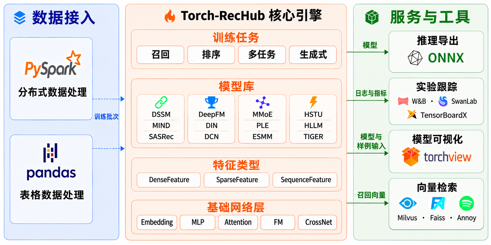

# 项目介绍

Torch-RecHub 用 PyTorch 实现了召回、排序、多任务和生成式推荐模型。第一次用，可以拿仓库自带的广告点击样本训练 DeepFM，看看一条曝光记录怎样变成一个点击概率。[快速开始](/zh/guide/quick_start)

## 框架架构

用自己的数据训练时，有三处代码最值得看。特征定义告诉模型读哪些列，例如 `item_id` 用来查嵌入表，`price` 直接作为数值输入。模型的 `forward` 决定怎样组合这些输入。训练器负责按批训练、计算验证指标和保存权重。想改某个模型，可以从它的 `forward` 读起。[特征定义](/zh/core/features) · [训练与评估](/zh/core/evaluation)

## 按任务选择模型

| 手上的问题 | 从哪里开始 |
| --- | --- |
| 商品库里有很多商品，先为每个用户挑出一批候选 | [用 DSSM 做召回](/zh/tutorials/retrieval) |
| 已经有了候选，希望用户最可能点击的排在前面 | [用 DeepFM 做排序](/zh/tutorials/ctr) |
| 同一次曝光既有点击标签，也有购买标签 | [多任务学习](/zh/tutorials/pipeline) |
| 有按时间排列的交互记录，希望预测下一件物品 | [序列与生成式模型](/zh/models/generative) |

例子可以在 CPU 上运行。使用 NVIDIA GPU、AMD GPU 或华为昇腾 NPU 时，先按设备安装对应的 PyTorch。模型训练好后，排序模型可以导出为 ONNX 做预测，双塔模型还可以分别导出用户和物品向量做检索。[安装指南](/zh/guide/install) · [部署示例](/zh/serving/demo)
