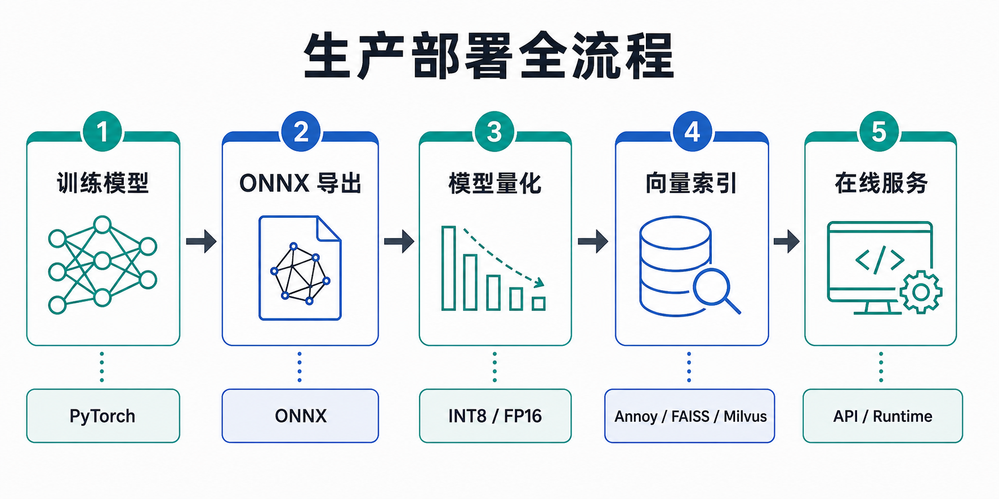

# 生产部署导览

训练结束后，排序和召回用到的文件不同。DeepFM 给一对用户和物品打分，部署时要带上模型、特征词表和归一化参数。DSSM 要先从物品库里找到候选，因此还要提前算好物品向量，把索引和对应的物品 ID 表一起保存。

第一次尝试，可以先用同一条记录比较 PyTorch 和 ONNX 的排序分数，或用一个用户向量查回电影 ID。这两步都可以在本地完成。[用训练好的模型做预测](/zh/serving/demo)

## 部署流程概览



## 快速开始

### 1. ONNX 导出

排序模型可以整体导出。双塔召回一般把两个塔分开，离线用物品塔建索引，请求到来时只运行用户塔。下面的 `ctr_trainer` 和 `match_trainer` 分别指已经训练好的两种训练器。[导出参数](/zh/serving/onnx)

```python
# 接在已训练的排序示例后，ctr_trainer 是持有最佳权重的训练器
ctr_trainer.export_onnx("model_fp32.onnx")

# 双塔模型分别导出
# 接在已训练的召回示例后，使用该模型的 match_trainer
match_trainer.export_onnx("user_tower.onnx", mode="user")
match_trainer.export_onnx("item_tower.onnx", mode="item")
```

### 2. 模型量化

先保留原始 FP32 文件。目标设备是 CPU 时可以试 INT8，支持半精度的 GPU 可以试 FP16。两者各用同一批真实样本与 FP32 比较分数和耗时，再决定上线用哪份模型。

```python
from torch_rechub.utils.quantization import quantize_model

# INT8 量化（推荐 CPU）
quantize_model("model_fp32.onnx", "model_int8.onnx", mode="int8")

# FP16 量化（推荐 GPU）
quantize_model("model_fp32.onnx", "model_fp16.onnx", mode="fp16")
```

### 3. 向量检索

下面用 Faiss 给物品向量建索引，再用用户向量查前 10 个候选。这里的 `ids` 是物品向量的行号，用建索引时的物品 ID 表就能换回原始 ID。[向量索引](/zh/serving/vector_index)

```bash
pip install "torch-rechub[faiss]"
```

```python
from torch_rechub.serving import builder_factory

# 创建 FAISS 索引
builder = builder_factory("faiss", index_type="HNSW", metric="IP")

with builder.from_embeddings(item_embeddings) as indexer:
    ids, scores = indexer.query(user_embeddings, top_k=10)
    indexer.save("item.index")
```

## 接入自己的服务

排序请求到达后，用训练时保存的词表和归一化参数处理候选物品的特征，再交给 ONNX Runtime 打分。推荐列表按分数排序返回。

召回分两个时间点。离线更新物品库时，物品塔为每件物品生成向量，写出索引和同一顺序的 ID 表。线上请求只需用用户塔生成当前用户的向量，查询这份索引并返回候选 ID。项目提供导出和查询接口，接收请求的 API 由业务服务实现。

