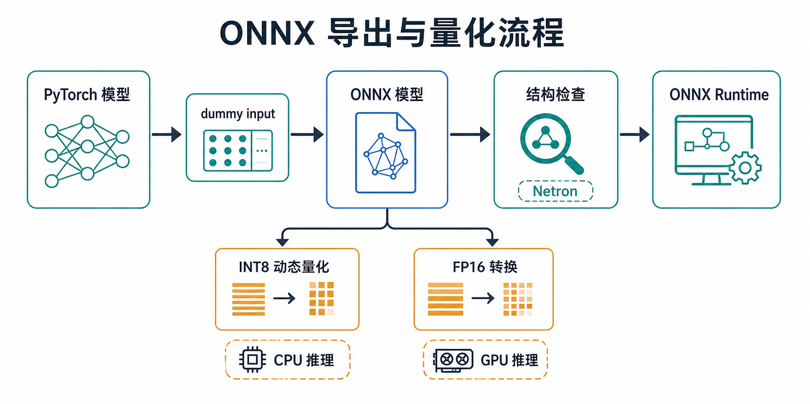

# ONNX 导出与量化

训练完成后，可以把模型导出为 `.onnx` 文件，用 ONNX Runtime 运行预测。先导出一份 FP32 模型，拿测试集里的一条记录与 PyTorch 对比分数。确认两边一致后，再根据推理设备尝试 INT8 或 FP16。[用同一条记录核对分数](/zh/serving/demo)



## 安装依赖

ONNX 相关依赖是可选的，按需安装：

```bash
pip install "torch-rechub[onnx]"
```

这组依赖包含 CPU 版 ONNX Runtime 和 FP16 转换工具。在 NVIDIA GPU 上做推理时，换成与本机 CUDA 和驱动匹配的 `onnxruntime-gpu`，用 `onnxruntime.get_available_providers()` 确认列表里有 `CUDAExecutionProvider`。

## 导出 ONNX（训练器 export_onnx）

下面的 `trainer` 都指各自示例中已经训练好的训练器。默认根据特征定义生成示例输入。已有测试批次时，也可以传 `dummy_input`，让导出的字段形状和实际输入一致。启用动态 batch 后，同一模型可以一次预测一条或多条记录。

### CTR（排序/精排）导出

```python
from torch_rechub.trainers import CTRTrainer

# ... trainer.fit(train_dl, val_dl)
trainer.export_onnx("deepfm.onnx")
```

### Matching（召回）导出：全模型 / 双塔分导

如果物品向量可以提前算好，分别导出两个塔。物品塔留给离线建索引的任务，用户塔用于处理新请求。也可以按 `MatchTrainer` 的默认模式导出完整模型。

```python
from torch_rechub.trainers import MatchTrainer

# 导出用户塔（用于 user embedding）
trainer.export_onnx("user_tower.onnx", mode="user")

# 导出物品塔（用于 item embedding）
trainer.export_onnx("item_tower.onnx", mode="item")
```

### 多任务（MTL）导出

```python
from torch_rechub.trainers import MTLTrainer

trainer.export_onnx("mmoe.onnx")
```

### 导出参数与高级控制（onnx_export_kwargs）

如果要指定 PyTorch 使用哪个导出器，把选项放在 `onnx_export_kwargs` 里。下面的 `dynamo=False` 会让 PyTorch 使用旧版导出器。Torch-RecHub 已设置的参数不能在这个字典里重复传入。

```python
trainer.export_onnx(
    "model.onnx",
    dynamic_batch=True,  # 动态 batch size（推荐）
    onnx_export_kwargs={
        "dynamo": False,  # 此处演示强制使用 legacy 导出器
    },
)
```

`f`、`input_names`、`output_names`、`opset_version`、`do_constant_folding`、`verbose` 和自动生成的 `dynamic_axes` 已由封装设置，不得在 `onnx_export_kwargs` 中重复传入，否则会抛出 `ValueError`。

多数模型可以先用默认导出器。CTR、Matching 和 MTL 会先尝试 Dynamo，用 `dynamic_shapes` 表示可变的批大小，失败时回到旧导出器的 `dynamic_axes`。如果当前 PyTorch 版本没有 `dynamo` 参数，封装会使用旧导出器。序列模型需要动态批大小或序列长度时，`SeqTrainer` 默认使用旧导出器，输入形状固定时可显式选择 Dynamo。

### 查看 ONNX 模型结构

把导出的 `.onnx` 文件拖到 Netron，可以查看输入名、数据类型和张量形状。这些信息在准备 ONNX Runtime 的输入字典时用得上。[Netron](https://netron.app/)

## ONNX 量化（Quantization）

选择哪种模式，先看模型最后在哪台机器上运行。

- **CPU 推理**可以试 `int8`。它对线性层、矩阵乘法等支持的算子做动态量化。
- **支持半精度的 GPU 推理**可以试 `fp16`。浮点权重占用的空间会变小，实际速度取决于显卡和模型用到的算子。

这两个模式处理常规单文件 ONNX 模型。超过 2 GB 的外部权重模型和 GPU INT8 校准需要另外的工具。下面两个例子分别从同一份 `model_fp32.onnx` 开始。

### 1) INT8 动态量化（推荐 CPU）

```python
from torch_rechub.utils.quantization import quantize_model

quantize_model("model_fp32.onnx", "model_int8.onnx", mode="int8")
```

需要调整 INT8 权重的表示方式时，可设置以下参数。
- `per_channel=True`：对权重启用 per-channel 量化
- `reduce_range=True`：缩小量化时可用的整数范围
- `weight_type="qint8"|"quint8"`：权重量化类型

旧脚本中的 `dynamic_int8`、`dynamic` 仍可作为 `int8` 的别名。需要只量化某些节点时，仍可传节点筛选参数。

**旧脚本用了 `optimize_model=True` 怎么办？** ONNX Runtime 从 1.16 起移除了这个参数。如果需要预处理模型，先运行 ORT 的 `quant_pre_process()`，再量化。

**Dynamo 导出的 Gemm 层在量化时遇到形状冲突怎么办？** ONNX Runtime 1.18 起，转换工具可以在内存中清理重复的形状信息，原始 ONNX 文件会保留。旧版 Runtime 遇到这个错误时，可以用 `onnx_export_kwargs={"dynamo": False}` 重新导出，再做量化。

### 2) FP16 转换（推荐 GPU）

```python
from torch_rechub.utils.quantization import quantize_model

quantize_model("model_fp32.onnx", "model_fp16.onnx", mode="fp16")
```

默认的 `keep_io_types=True` 会让浮点输入和输出继续使用 FP32，因此调用方可以沿用原来的输入。整数类别 ID 仍用原类型。如果推理端也准备改用半精度浮点输入，传 `keep_io_types=False`，命令行对应 `--no-keep-io-types`。旧脚本使用的模式名 `float16` 也可继续使用。

## 脚本示例与基准测试（Benchmark）

下面的命令从仓库根目录运行，文件名替换成自己的模型路径。

### 量化脚本

```bash
python examples/serving/quantize_onnx.py --input model_fp32.onnx --output model_int8.onnx --mode int8
python examples/serving/quantize_onnx.py --input model_fp32.onnx --output model_fp16.onnx --mode fp16
```

### 性能对比脚本

对比 FP32 / INT8 / FP16 的 **模型大小** 与 **推理耗时**：

```bash
python examples/serving/benchmark_onnx_quantization.py --fp32 model_fp32.onnx --int8 model_int8.onnx --inputs batch.npz
python examples/serving/benchmark_onnx_quantization.py --fp32 model_fp32.onnx --fp16 model_fp16.onnx --inputs batch.npz --provider CUDAExecutionProvider
```

用 `batch.npz` 固定本次比较的输入。键与 ONNX 的输入名一致，例如 `np.savez("batch.npz", user_id=user_ids, item_id=item_ids)`。有类别 ID、掩码或序列长度时，传入经过训练时预处理的真实值，并保持各字段的数据类型。只有浮点输入的模型也可以省略 `--inputs`，此时脚本使用固定种子的随机数。

同一批样本会依次送入各个模型。如果 FP16 模型改变了浮点输入类型，脚本会做相应的类型转换。GPU 模式会检查 CUDA provider 是否已注册，具体算子在哪个设备执行仍取决于模型和 Runtime。

结果中的文件大小只统计 `.onnx` 本身。CPU 算子固定使用一个线程，计时包含输入和输出的拷贝。比较速度之后，还要在同一份验证集上检查量化前后的指标，例如排序模型的 AUC 和 LogLoss。

