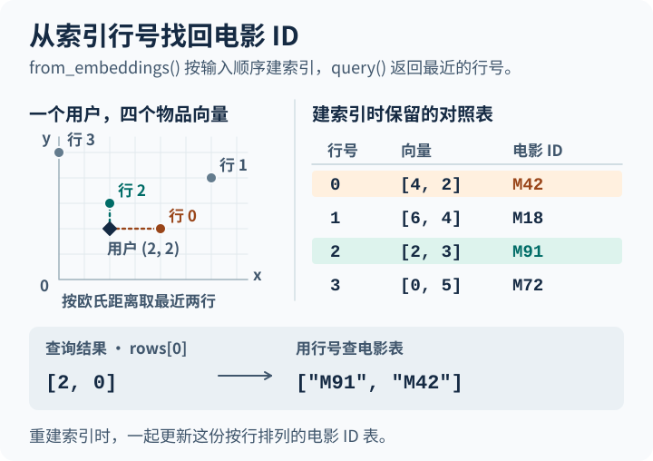

# 向量检索封装

双塔模型为每个物品算出一个向量。给用户做召回时，用这个用户的向量查索引，取回最接近的物品。Annoy、Faiss 和 Milvus 都使用下面的 `from_embeddings` 建索引、`query` 查候选，区别主要在索引的保存方式和运行环境。



## 安装

下面的例子使用 Faiss，在当前 Python 环境运行 `pip install "torch-rechub[faiss]"` 即可。使用 Annoy 或 Milvus 时，安装本页对应后端的依赖。

## 快速开始

先用 1,000 个物品和 10 个用户的随机向量看清输入输出。每个向量都是 64 维，每位用户取 10 个候选，所以 `ids` 和 `scores` 的形状都是 `[10, 10]`。实际召回时，用物品塔和用户塔算出的向量替换随机数。

```python
import torch
from torch_rechub.serving import builder_factory

# 准备嵌入向量
item_embeddings = torch.randn(1000, 64, dtype=torch.float32)  # 1000个物品，64维
user_embeddings = torch.randn(10, 64, dtype=torch.float32)    # 10个用户，64维

# 创建 Builder 并构建索引
builder = builder_factory("faiss", index_type="Flat", metric="L2")

with builder.from_embeddings(item_embeddings) as indexer:
    # 查询 Top-K
    ids, scores = indexer.query(user_embeddings, top_k=10)
    # ids 是向量行号。部署时用与 item_embeddings 等长、同序的物品 ID 表还原结果。
    # 保存索引
    indexer.save("item.index")

# 加载已有索引
with builder.from_index_file("item.index") as indexer:
    ids, scores = indexer.query(user_embeddings, top_k=10)
```

`ids[0]` 是第一位用户的候选行号。例如行号 7 对应传入 `item_embeddings` 的第 8 行。保存索引时，记得保留一份顺序相同的物品 ID 表，供之后把行号换回原始 ID。[用电影 ID 还原查询结果](/zh/serving/demo)

这里的 `scores` 是 Faiss 的 L2 平方距离，越小越近。改用内积（`IP`）或余弦相似度（`COSINE`）时，分数越大越相似。

## 核心概念

### Builder-Indexer 模式

`builder` 记住后端名称、向量维度和距离度量。调用 `builder.from_embeddings(...)` 后，在 `with` 块里用 `indexer.query(...)` 查询。Annoy 和 Faiss 都可以把这份索引存成文件，下次用 `from_index_file(...)` 重新打开。

### 工厂函数

```python
from torch_rechub.serving import builder_factory

builder = builder_factory(model, **builder_config)
```

| 参数               | 类型   | 说明                                             |
| ------------------ | ------ | ------------------------------------------------ |
| `model`            | `str`  | 检索后端名称：`"annoy"`、`"faiss"` 或 `"milvus"` |
| `**builder_config` | `dict` | 传递给具体 Builder 的配置参数                    |

---

## Annoy

Annoy 适合提前建好索引、把文件部署到本机的召回流程。加载时会将索引文件映射到内存。[Annoy 项目](https://github.com/spotify/annoy)

### 后端依赖

```bash
pip install "torch-rechub[annoy]"
```

Annoy 包含 C++ 扩展。如果当前平台没有预编译包，Linux/macOS 需要 GCC 或 Clang，Windows 需要 Visual Studio Build Tools。[Windows 安装问题](/zh/community/faq)

### 参数说明

```python
builder = builder_factory(
    "annoy",
    d=64,                    # 向量维度（必需）
    metric="angular",        # 距离度量
    n_trees=10,              # 树的数量
    threads=-1,              # 构建时的线程数
    searchk=-1,              # 搜索时检查的节点数
)
```

| 参数      | 类型  | 默认值      | 说明                                                                  |
| --------- | ----- | ----------- | --------------------------------------------------------------------- |
| `d`       | `int` | 必需        | 向量维度                                                              |
| `metric`  | `str` | `"angular"` | 距离度量：`"angular"`（角距离）、`"euclidean"`（欧氏）、`"dot"`（点积） |
| `n_trees` | `int` | `10`        | 构建的树数量，越多精度越高但构建越慢                                  |
| `threads` | `int` | `-1`        | 构建线程数，`-1` 表示使用所有可用核心                                 |
| `searchk` | `int` | `-1`        | 搜索时检查的节点数，`-1` 表示 `n_trees * top_k`                       |

### 使用示例

```python
import torch
from torch_rechub.serving import builder_factory

item_embeddings = torch.randn(1000, 64, dtype=torch.float32)
user_embeddings = torch.randn(10, 64, dtype=torch.float32)

# 使用 angular 距离，越小越相似
builder = builder_factory(
    "annoy",
    d=64,
    metric="angular",
    n_trees=50,
    searchk=100,
)

with builder.from_embeddings(item_embeddings) as indexer:
    ids, distances = indexer.query(user_embeddings, top_k=10)
    indexer.save("annoy.index")
    
print(f"候选物品行号: {ids}")
print(f"距离: {distances}")
```

---

## FAISS

Faiss 可以做精确搜索，也可以用近似索引减少查询时访问的候选数量。Torch-RecHub 的 `FaissBuilder` 在 CPU 上构建和查询索引。[Faiss 项目](https://github.com/facebookresearch/faiss)

### 后端依赖

```bash
pip install "torch-rechub[faiss]"
```

### 支持的索引类型

| 索引 | 查询方式 | 什么时候试 |
| --- | --- | --- |
| `Flat` | 逐一比较所有物品向量 | 先得到精确结果，作为后面比较召回率的参照 |
| `HNSW` | 沿索引图访问邻近向量 | 希望缩短查询时间，且内存能容下索引图 |
| `IVF` | 先聚类，查询时只搜索选中的簇 | 物品库较大，准备好用 `nprobe` 调整搜索范围 |

### 参数说明

#### Flat 索引

```python
builder = builder_factory(
    "faiss",
    index_type="Flat",       # 索引类型
    metric="L2",             # 距离度量
)
```

| 参数         | 类型  | 默认值   | 说明                                         |
| ------------ | ----- | -------- | -------------------------------------------- |
| `index_type` | `str` | `"Flat"` | 索引类型                                     |
| `metric`     | `str` | `"L2"`   | 距离度量：`"L2"`（欧氏距离）、`"IP"`（内积） |

#### HNSW 索引

```python
builder = builder_factory(
    "faiss",
    index_type="HNSW",
    metric="L2",
    m=32,                    # 每个节点的最大邻居数
    efSearch=50,             # 搜索时的候选节点数
)
```

| 参数       | 类型  | 默认值 | 说明                                   |
| ---------- | ----- | ------ | -------------------------------------- |
| `m`        | `int` | `32`   | 每个节点的最大邻居数，越大精度越高     |
| `efSearch` | `int` | `None` | 搜索时的候选节点数，越大精度越高但越慢 |

#### IVF 索引

```python
builder = builder_factory(
    "faiss",
    index_type="IVF",
    metric="L2",
    nlists=100,              # 聚类中心数量
    nprobe=10,               # 搜索时访问的聚类数
)
```

| 参数     | 类型  | 默认值 | 说明                                          |
| -------- | ----- | ------ | --------------------------------------------- |
| `nlists` | `int` | `100`  | 聚类中心数量，建议为 `sqrt(n)` 到 `4*sqrt(n)` |
| `nprobe` | `int` | `None` | 搜索时访问的聚类数，越大精度越高但越慢        |

### 使用示例

```python
import torch
from torch_rechub.serving import builder_factory

item_embeddings = torch.randn(10000, 128, dtype=torch.float32)
user_embeddings = torch.randn(100, 128, dtype=torch.float32)

# 使用 HNSW 索引
builder = builder_factory(
    "faiss",
    index_type="HNSW",
    metric="IP",  # 内积，适合归一化后的向量
    m=32,
    efSearch=64,
)

with builder.from_embeddings(item_embeddings) as indexer:
    ids, distances = indexer.query(user_embeddings, top_k=20)
    indexer.save("faiss_hnsw.index")
```

---

## Milvus

已有运行中的 Milvus 服务时，可以用同样的 `query` 接口测试服务端的索引。下面的示例会创建一个临时集合（collection），退出 `with` 时删除。[Milvus 项目](https://milvus.io/)

### 后端依赖与服务

```bash
pip install "torch-rechub[milvus]"
```

上面的命令安装 Python 客户端。还没有服务时，先按 Milvus 的安装文档启动 Standalone 并确认能够连接，再运行查询示例。[Milvus Docker 安装文档](https://milvus.io/docs/install_standalone-docker.md)

### 支持的索引类型

| 索引类型   | 说明         | 适用场景             |
| ---------- | ------------ | -------------------- |
| `FLAT`     | 暴力搜索     | 小规模数据，精确结果 |
| `HNSW`     | 基于图的索引 | 中等规模，高召回率   |
| `IVF_FLAT` | 倒排索引     | 大规模数据           |

### 参数说明

#### FLAT 索引

```python
builder = builder_factory(
    "milvus",
    d=64,                    # 向量维度（必需）
    index_type="FLAT",
    metric="COSINE",         # 默认距离度量
)
```

| 参数     | 类型  | 默认值 | 说明                                 |
| -------- | ----- | ------ | ------------------------------------ |
| `d`      | `int` | 必需   | 向量维度                             |
| `metric` | `str` | `"COSINE"` | 距离度量：`"L2"`、`"IP"`、`"COSINE"` |

#### HNSW 索引

```python
builder = builder_factory(
    "milvus",
    d=64,
    index_type="HNSW",
    metric="COSINE",
    m=30,                    # 每个节点的最大邻居数
    ef=50,                   # 搜索时的候选节点数
)
```

| 参数 | 类型  | 默认值 | 说明                 |
| ---- | ----- | ------ | -------------------- |
| `m`  | `int` | `30`   | 每个节点的最大邻居数 |
| `ef` | `int` | `None` | 搜索时的候选节点数   |

#### IVF_FLAT 索引

```python
builder = builder_factory(
    "milvus",
    d=64,
    index_type="IVF_FLAT",
    metric="IP",
    nlist=128,               # 聚类中心数量
    nprobe=16,               # 搜索时访问的聚类数
)
```

| 参数     | 类型  | 默认值 | 说明               |
| -------- | ----- | ------ | ------------------ |
| `nlist`  | `int` | `128`  | 聚类中心数量       |
| `nprobe` | `int` | `None` | 搜索时访问的聚类数 |

### 使用示例

```python
import torch
from torch_rechub.serving import builder_factory

item_embeddings = torch.randn(10000, 64, dtype=torch.float32)
user_embeddings = torch.randn(100, 64, dtype=torch.float32)

# 使用 Milvus HNSW 索引
builder = builder_factory(
    "milvus",
    d=64,
    index_type="HNSW",
    metric="COSINE",
    m=32,
    ef=64,
)

with builder.from_embeddings(item_embeddings) as indexer:
    ids, distances = indexer.query(user_embeddings, top_k=10)
    # 当前封装不支持本地 save
```

需要下次还能查询同一份数据时，请用 Milvus 客户端自己创建并维护集合。本例的 `save()` 和 `from_index_file()` 均未实现。

---

## 完整示例：召回模型评估

下面用测试用户的向量查询物品索引，再把候选行号换成原始物品 ID，与测试集保留的真实交互比较。这里每个用户只有一个向量，输入的用户表和物品表分别与两组向量逐行对应。MIND 和 ComiRec 每人有多个兴趣向量，需要先分别查询，再合并同一用户的候选。[MIND 多兴趣召回示例](/zh/tutorials/models/matching/mind)

```python
import collections
import numpy as np
import pandas as pd
import torch
from torch_rechub.serving import builder_factory
from torch_rechub.basic.metric import topk_metrics

def match_evaluation(
    user_embedding: torch.Tensor,
    item_embedding: torch.Tensor,
    test_user: dict,
    all_item: dict,
    user_col: str = 'user_id',
    item_col: str = 'item_id',
    raw_id_maps: str = "./raw_id_maps.npy",
    topk: int = 10,
    backend: str = "faiss",
    **backend_kwargs,
):
    """
    使用向量检索进行召回评估
    
    Args:
        user_embedding: 用户嵌入向量 (n_users, dim)
        item_embedding: 物品嵌入向量 (n_items, dim)
        test_user: 测试用户数据字典
        all_item: 全量物品数据字典
        user_col: 用户ID列名
        item_col: 物品ID列名
        raw_id_maps: ID映射文件路径
        topk: 召回数量
        backend: 检索后端 ("annoy", "faiss", "milvus")
        **backend_kwargs: 传递给 builder_factory 的额外参数
    
    Returns:
        评估指标字典
    """
    print(f"使用 {backend} 进行向量化召回评估")
    
    # 1. 创建 Builder
    dim = item_embedding.shape[1]
    
    if backend == "annoy":
        config = {"d": dim, "n_trees": 10}
    elif backend == "faiss":
        config = {"index_type": "Flat", "metric": "L2"}
    elif backend == "milvus":
        config = {"d": dim, "index_type": "FLAT", "metric": "L2"}
    else:
        raise ValueError(f"不支持的后端: {backend}")
    # 调用方参数覆盖默认值，避免重复关键字（如 index_type）
    config.update(backend_kwargs)
    builder = builder_factory(backend, **config)
    
    # 2. 确保张量在 CPU 上
    item_embedding = item_embedding.cpu().float()
    user_embedding = user_embedding.cpu().float()
    
    # 3. 加载 ID 映射
    user_map, item_map = np.load(raw_id_maps, allow_pickle=True)
    
    # 4. 构建索引并查询
    match_res = collections.defaultdict(dict)
    
    with builder.from_embeddings(item_embedding) as indexer:
        ids, distances = indexer.query(user_embedding, topk)
        ids_np = ids.numpy()
        
        for i, user_id in enumerate(test_user[user_col]):
            items_idx = ids_np[i]
            predicted_item_ids = all_item[item_col][items_idx]
            match_res[user_map[user_id]] = np.vectorize(item_map.get)(predicted_item_ids)
    
    # 5. 构建 ground truth
    data = pd.DataFrame({user_col: test_user[user_col], item_col: test_user[item_col]})
    data[user_col] = data[user_col].map(user_map)
    data[item_col] = data[item_col].map(item_map)
    user_pos_item = data.groupby(user_col).agg(list).reset_index()
    ground_truth = dict(zip(user_pos_item[user_col], user_pos_item[item_col]))
    
    # 6. 计算指标
    out = topk_metrics(y_true=ground_truth, y_pred=match_res, topKs=[topk])
    return out


# 使用示例
# result = match_evaluation(
#     user_embedding, item_embedding, test_user, all_item,
#     topk=10, backend="faiss", index_type="HNSW", m=32
# )
```

---

## 性能对比与选型建议

如果想把索引存成本地文件，Annoy 和 Faiss 都支持 `save()`。MovieLens 教程给出了 Annoy 的完整例子。需要精确搜索做对照，或想比较 HNSW 和 IVF，就用 Faiss。已经在维护 Milvus 服务，可以用这里的临时集合做离线评估，长期保存集合则交给自己的服务。[从用户向量查回电影 ID](/zh/serving/demo)

## API 参考

### BaseBuilder

```python
class BaseBuilder(abc.ABC):
    def from_embeddings(self, embeddings: torch.Tensor) -> ContextManager[BaseIndexer]:
        """从嵌入向量构建索引"""
        
    def from_index_file(self, index_file: FilePath) -> ContextManager[BaseIndexer]:
        """从文件加载索引"""
```

### BaseIndexer

```python
class BaseIndexer(abc.ABC):
    def query(self, embeddings: torch.Tensor, top_k: int) -> tuple[torch.Tensor, torch.Tensor]:
        """
        查询最近邻
        
        Args:
            embeddings: 查询向量 (n, d)
            top_k: 返回的最近邻数量
            
        Returns:
            ids: 最近邻ID (n, top_k)
            distances: 距离 (n, top_k)
        """
        
    def save(self, file_path: FilePath) -> None:
        """保存索引到文件"""
```

`from_index_file()` 和 `save()` 适用于 Annoy 和 Faiss。对当前的 Milvus 后端调用这两个方法会得到 `NotImplementedError`。
