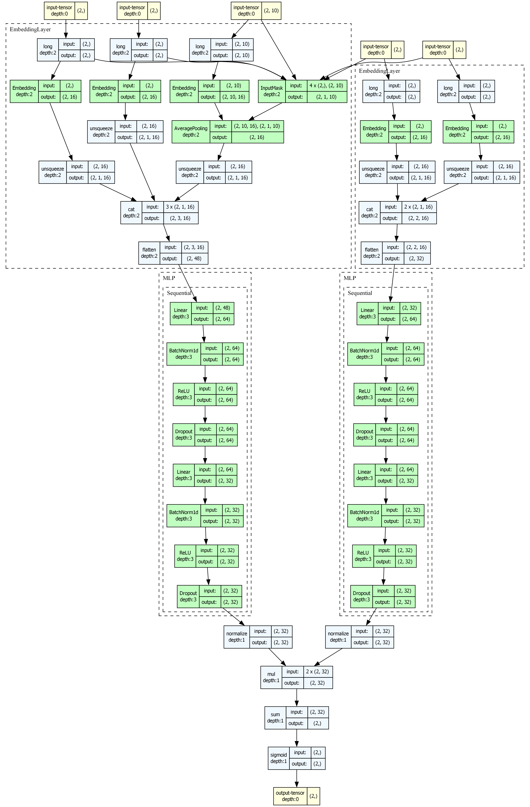

# DSSM 使用示例

## 1. 模型简介与适用场景

DSSM 把用户和电影分别编码成向量。用户塔看用户属性和观影历史，物品塔看电影 ID 和类型。训练好后，整份片单的电影向量只需算一次。要为某个人推荐电影，就用他的向量到片单里找最相近的几部。

**论文**: [Learning Deep Structured Semantic Models for Web Search using Clickthrough Data](https://posenhuang.github.io/papers/cikm2013_DSSM_fullversion.pdf)

### 模型结构

<div align="center">
  
</div>

图中两侧可以分别计算。这里两座塔最后都输出 64 维向量，匹配分数由两向量的余弦相似度决定。

---

## 2. 数据准备与预处理

本页读取仓库随附的 MovieLens-1M 样本文件。一行表示某个用户在某个时间为一部电影评分。示例用这次交互构造正样本，评分的具体数值不作为回归目标。

### 2.1 加载和处理数据

```python
import os
import numpy as np
import pandas as pd
import torch
from sklearn.preprocessing import LabelEncoder

from torch_rechub.basic.features import SparseFeature, SequenceFeature
from torch_rechub.utils.data import MatchDataGenerator, df_to_dict
from torch_rechub.utils.match import gen_model_input, generate_seq_feature_match

# 加载 MovieLens 采样数据
data = pd.read_csv("examples/matching/data/ml-1m/ml-1m_sample.csv")
data["cate_id"] = data["genres"].apply(lambda x: x.split("|")[0])

# 定义离散特征
sparse_features = ['user_id', 'movie_id', 'gender', 'age', 'occupation', 'zip', 'cate_id']
user_col, item_col = "user_id", "movie_id"
```

### 2.2 特征编码

```python
raw_id_maps = {}
feature_max_idx = {}
for feature in sparse_features:
    lbe = LabelEncoder()
    data[feature] = lbe.fit_transform(data[feature]) + 1
    feature_max_idx[feature] = data[feature].max() + 1

    # 评估工具需要将编码 ID 映射回原始用户和电影
    if feature in (user_col, item_col):
        raw_id_maps[feature] = dict(enumerate(lbe.classes_, start=1))

os.makedirs("saved/dssm", exist_ok=True)
np.save("saved/dssm/raw_id_maps.npy", [raw_id_maps[user_col], raw_id_maps[item_col]])

# 提取用户/物品 profile
user_profile = data[["user_id", "gender", "age", "occupation", "zip"]].drop_duplicates("user_id")
item_profile = data[["movie_id", "cate_id"]].drop_duplicates("movie_id")
```

### 2.3 构建序列特征和训练数据

```python
# 生成序列特征（用户历史行为序列）和负采样
df_train, df_test = generate_seq_feature_match(
    data, user_col, item_col,
    time_col="timestamp",
    item_attribute_cols=[],
    sample_method=1,    # 按物品流行度的 0.75 次幂采样
    mode=0,             # point-wise
    neg_ratio=3,        # 负样本比例
    min_item=0
)

# 构建模型输入
x_train = gen_model_input(df_train, user_profile, user_col, item_profile, item_col, seq_max_len=50)
y_train = x_train["label"]
x_train = {k: v for k, v in x_train.items() if k != "label"}
x_test = gen_model_input(df_test, user_profile, user_col, item_profile, item_col, seq_max_len=50)
```

### 2.4 定义特征

```python
user_cols = ['user_id', 'gender', 'age', 'occupation', 'zip']
item_cols = ['movie_id', 'cate_id']

# 用户特征 = 用户属性 + 历史行为序列
# DSSM 不直接建模复杂时序关系，而是先把历史行为压成一个固定 user 向量
user_features = [
    SparseFeature(name, vocab_size=feature_max_idx[name], embed_dim=16)
    for name in user_cols
]
user_features += [
    SequenceFeature(
        "hist_movie_id",
        vocab_size=feature_max_idx["movie_id"],
        embed_dim=16,
        pooling="mean",           # 序列聚合方式
        shared_with="movie_id", padding_idx=0,
    )
]

# 物品特征
item_features = [
    SparseFeature(name, vocab_size=feature_max_idx[name], embed_dim=16, padding_idx=0)
    for name in item_cols
]

# 用于评估的全量物品数据
all_item = df_to_dict(item_profile)
test_user = x_test
```

### 2.5 创建 DataLoader

```python
dg = MatchDataGenerator(x=x_train, y=y_train)
train_dl, test_dl, item_dl = dg.generate_dataloader(
    test_user, all_item, batch_size=4096, num_workers=0
)
```

---

## 3. 模型配置与参数说明

### 3.1 创建模型

```python
from torch_rechub.models.matching import DSSM

model = DSSM(
    user_features=user_features,
    item_features=item_features,
    temperature=1.0,  # 用于全 batch in-batch 训练，不影响 point-wise BCE
    user_params={
        "dims": [256, 128, 64],
        "activation": "prelu"      # 隐藏层使用 PReLU
    },
    item_params={
        "dims": [256, 128, 64],
        "activation": "prelu"
    }
)
```

### 3.2 参数详解

| 参数 | 类型 | 说明 | 建议值 |
|------|------|------|--------|
| `user_features` | `list[Feature]` | 用户侧特征列表 | 用户属性 + 行为序列 |
| `item_features` | `list[Feature]` | 物品侧特征列表 | 物品ID + 属性 |
| `temperature` | `float` | 批内交叉熵的温度，取有限正数 | 默认 1.0 |
| `user_params.dims` | `list[int]` | User Tower MLP 维度 | `[256, 128, 64]` |
| `item_params.dims` | `list[int]` | Item Tower MLP 维度 | `[256, 128, 64]` |
| `*_params.activation` | `str` | 激活函数 | 本例用 `"prelu"` |

上面的默认训练方式先算用户与电影的余弦相似度，再用 sigmoid 得到分数。`temperature` 在第 4.3 节的批内采样中才用到。

---

## 4. 训练过程与代码示例

### 4.1 训练模型

```python
import os
from torch_rechub.trainers import MatchTrainer

torch.manual_seed(2022)
save_dir = "./saved/dssm/"
os.makedirs(save_dir, exist_ok=True)

trainer = MatchTrainer(
    model,
    mode=0,                        # 0: point-wise, 1: pair-wise, 2: list-wise
    optimizer_params={
        "lr": 1e-4,
        "weight_decay": 1e-6
    },
    n_epoch=10,
    device="cpu",
    model_path=save_dir
)

trainer.fit(train_dl)
```

### 4.2 训练模式说明

| mode | 训练方式 | 损失函数 | 说明 |
|------|---------|---------|------|
| 0 | Point-wise | BCE Loss | 对每个样本独立计算 |
| 1 | Pair-wise | BPR Loss | 需要模型返回 `(pos_score, neg_score)`，如 `FaceBookDSSM` |
| 2 | List-wise | Softmax Loss | 需要模型返回 `[B, 1+n_neg]` logits，如 `YoutubeDNN` / `MIND` |

本页的 DSSM 给每对用户和电影输出一个分数，因此传 `mode=0`。表中的另两种模式对应不同形状的模型输出。

### 4.3 单设备 in-batch 训练

在 `examples/matching` 目录运行：

```bash
python run_ml_dssm.py --in_batch_neg --batch_size 256 --temperature 0.02 --device cpu
```

在一张 NVIDIA 显卡上跑时，把 `--device cpu` 换成 `--device cuda:0`。脚本会为批内采样另外生成训练数据。省略 `--in_batch_neg` 就沿用原先的正负样本和 BCE 损失。

自己准备数据时，每行只放一次真实的用户和电影交互。一批有 `B` 行，用户塔和物品塔各输出 `B` 个向量。训练器计算 `user_emb @ item_emb.T / model.temperature`，让每一行对角线上的电影得分高于其他电影。同一部电影在批内出现两次时，也按这个位置规则处理。每批至少要有两行，只有一行的尾批会被跳过。

完整的 Python 写法见[召回训练教程](/zh/tutorials/retrieval)。从构造训练集开始使用同一个开关，取向量时也要读这一轮保存的权重。可以用留出的电影评估召回列表。如果还想算 AUC，请另备一份同时包含 0 和 1 标签的验证集。

---

## 5. 模型评估与结果分析

### 5.1 生成向量并评估

DSSM 的评估需要先生成 User 和 Item 的 Embedding 向量，再使用向量检索方式计算 Recall@K。

```python
# 生成 User Embedding
user_embedding = trainer.inference_embedding(
    model=model, mode="user",
    data_loader=test_dl,
    model_path=save_dir
)

# 生成 Item Embedding
item_embedding = trainer.inference_embedding(
    model=model, mode="item",
    data_loader=item_dl,
    model_path=save_dir
)

print(f"User Embedding shape: {user_embedding.shape}")
print(f"Item Embedding shape: {item_embedding.shape}")
```

### 5.2 Recall@K 评估

```python
# 需要 match_evaluation 辅助函数
# 位于 examples/matching/movielens_utils.py
from examples.matching.movielens_utils import match_evaluation

match_evaluation(
    user_embedding,
    item_embedding,
    test_user,
    all_item,
    raw_id_maps="saved/dssm/raw_id_maps.npy",
    topk=10,
)
```

---

## 6. 参数调优建议

### 6.1 关键调优点

两座塔的中间层宽度可以各自调整，最后一层要保持同样宽，才能计算向量内积。默认配对训练中，`neg_ratio=3` 表示一次正交互配 3 个负例。用批内采样时，每个用户看到多少个候选由实际批大小决定。

### 6.2 向量检索与部署

训练完成后，可以将 Embedding 插入向量索引进行 ANN（近似最近邻）搜索。项目同时保留了 `torch_rechub.utils.match` 下的旧封装，以及 `torch_rechub.serving` 下的 Builder/Indexer API。

#### 方式一：Annoy（轻量级，适合快速原型）

```bash
pip install "torch-rechub[annoy]"
```

```python
from torch_rechub.utils.match import Annoy

# 构建 Annoy 索引
annoy = Annoy(n_trees=10, metric='angular')
annoy.fit(item_embedding)

# 为单个用户查询 Top-10 相似物品
indices, distances = annoy.query(user_embedding[0], n=10)
print(f"Top-10 Item 索引: {indices}")
print(f"对应距离: {distances}")
```

#### 方式二：Faiss（本项目可选依赖为 CPU 版）

```bash
pip install "torch-rechub[faiss]"
```

```python
from torch_rechub.utils.match import Faiss
import numpy as np

# 确保 embedding 是 float32 numpy 数组
item_emb_np = item_embedding.cpu().numpy().astype(np.float32)
user_emb_np = user_embedding.cpu().numpy().astype(np.float32)

# 创建 Faiss 索引（支持 flat / ivf / hnsw）
faiss_index = Faiss(dim=item_emb_np.shape[1], index_type='flat', metric='l2')
faiss_index.fit(item_emb_np)

# 查询 Top-10
indices, distances = faiss_index.query(user_emb_np[0], n=10)
print(f"Top-10 Item 索引: {indices}")
# metric='l2' 时 distances 是距离，数值越小越近

# 保存 / 加载索引
faiss_index.save_index("item_faiss.index")
faiss_index.load_index("item_faiss.index")
```

> **Faiss 索引类型选择**（实际规模上限取决于维度、内存和检索参数，应以压测为准）：
> | 类型 | 特点 | 适用场景 |
> |------|------|---------|
> | `flat` | 精确搜索，无需训练 | 小规模或作为召回率基线 |
> | `ivf` | 倒排索引，需训练 | 需要在速度与召回率间权衡 |
> | `hnsw` | 图索引，无需训练 | 高召回率需求 |

使用可持久化的本地索引时，可复用[按索引行号查回原始电影的示例](/zh/serving/demo)。使用 Milvus 前先阅读[向量索引文档](/zh/serving/vector_index)里的临时集合生命周期。旧版 `torch_rechub.utils.match.Milvus` 在构造时会删除名为 `rechub` 的已有集合。

## 7. 模型可视化

Torch-RecHub 内置了基于 `torchview` 的模型结构可视化工具，可以生成模型的计算图。

### 安装依赖

```bash
pip install torch-rechub[visualization]
# 还需要安装系统级 graphviz:
# Ubuntu: sudo apt-get install graphviz
# macOS: brew install graphviz
# Windows: choco install graphviz
```

### 可视化 DSSM 模型

```python
from torch_rechub.utils.visualization import visualize_model

# 自动生成输入并可视化（在 Jupyter 中直接显示）
graph = visualize_model(model, depth=4)

# 保存为图片（适合论文/文档）
visualize_model(model, save_path="dssm_architecture.png", dpi=300)

# 保存为 PDF
visualize_model(model, save_path="dssm_architecture.pdf")
```

> 可视化会自动从模型中提取特征信息生成 dummy input，无需手动构造输入数据。


### DSSM 架构图


---

## 8. ONNX 导出

先安装 ONNX 可选依赖，再导出模型：

```bash
pip install "torch-rechub[onnx]"
```

导出文件可以交给兼容的 ONNX Runtime 使用；具体服务和部署流程不包含在项目中。

### 导出完整模型

```python
from torch_rechub.utils.onnx_export import ONNXExporter

exporter = ONNXExporter(model, device="cpu")

# 导出完整 DSSM 模型
exporter.export("dssm_full.onnx", verbose=True)
```

### 分别导出 User Tower 和 Item Tower

双塔模型可以分别导出两个 Tower，用于独立部署：

```python
# 导出 User Tower（线上实时推理）
exporter.export("dssm_user_tower.onnx", mode="user")

# 导出 Item Tower（离线批量计算）
exporter.export("dssm_item_tower.onnx", mode="item")
```

### 使用 ONNX Runtime 推理

```python
import onnxruntime as ort
import numpy as np

# 加载 User Tower
session = ort.InferenceSession("dssm_user_tower.onnx")

# 查看输入信息
for inp in session.get_inputs():
    print(f"  {inp.name}: shape={inp.shape}, type={inp.type}")

# 构造输入并推理
input_feed = {}
for inp in session.get_inputs():
    shape = [dim if isinstance(dim, int) else 1 for dim in inp.shape]
    dtype = np.int64 if "int" in inp.type.lower() else np.float32
    input_feed[inp.name] = np.zeros(shape, dtype=dtype)
output = session.run(None, input_feed)
print(f"User Embedding shape: {output[0].shape}")
```

---

## 9. 常见问题与解决方案

### Q1: User Tower 和 Item Tower 的 dims 必须相同吗？
最终输出维度（`dims[-1]`）必须相同，因为需要计算相似度。中间层维度可以不同。

### Q2: 如何加入用户行为序列特征？
使用 `SequenceFeature` 定义历史行为序列，通过 `shared_with` 参数与物品 ID 共享 Embedding：

```python
SequenceFeature("hist_movie_id", vocab_size=n_movie,
                embed_dim=16, pooling="mean",
                shared_with="movie_id", padding_idx=0)
```

### Q3: 线上如何高效部署 DSSM？
关键思路是 **User 和 Item 解耦**：
1. 离线计算所有 Item Embedding，存入向量数据库（Faiss/Milvus）
2. 线上用 ONNX Runtime 实时计算 User Embedding
3. 通过 ANN 检索最相似的 Top-K Item

### Q4: temperature 会影响当前 DSSM 吗？
开启批内采样时，训练器把每个相似度除以 `temperature`，再计算交叉熵。使用本页默认的配对训练时，改它不会改变输出。

### Q5: Annoy、Faiss、Milvus 如何选择？

| 特性 | Annoy | Faiss | Milvus |
|------|-------|-------|--------|
| 安装复杂度 | 简单 | 中等 | 需要服务 |
| 项目可选依赖 | `annoy` | `faiss-cpu` | `pymilvus` |
| 持久化 | 可保存索引 | 可保存索引 | 当前 Serving 上下文退出即删临时 collection |
| 当前建议 | 快速原型 | 单机实验与压测 | 仅在隔离实例验证，勿直接用于持久化生产数据 |

---

## 运行仓库示例

从仓库根目录执行。脚本会保存映射和权重，并评估召回列表。

```bash
cd examples/matching
uv run --extra annoy python run_ml_dssm.py --epoch 1 --device cpu
```
